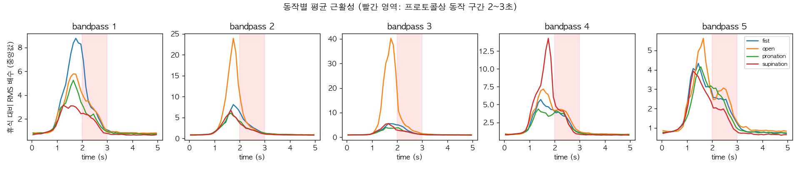
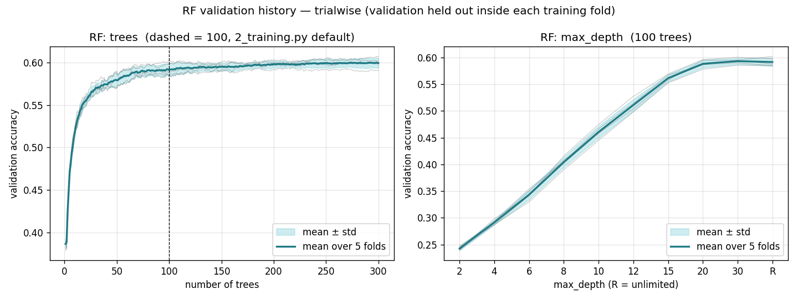
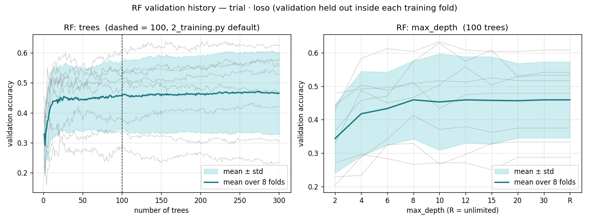
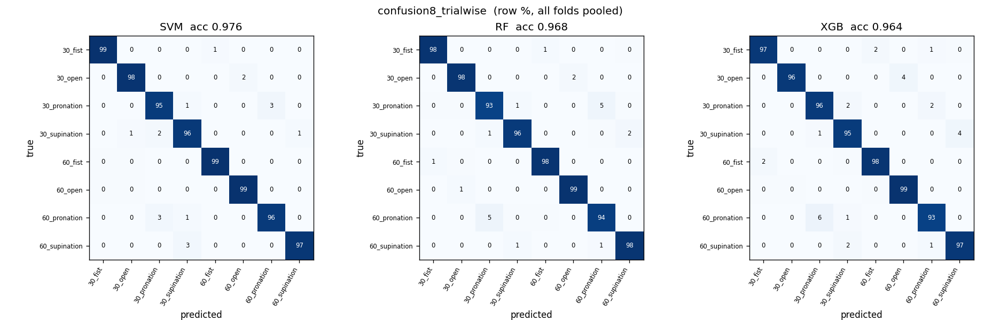
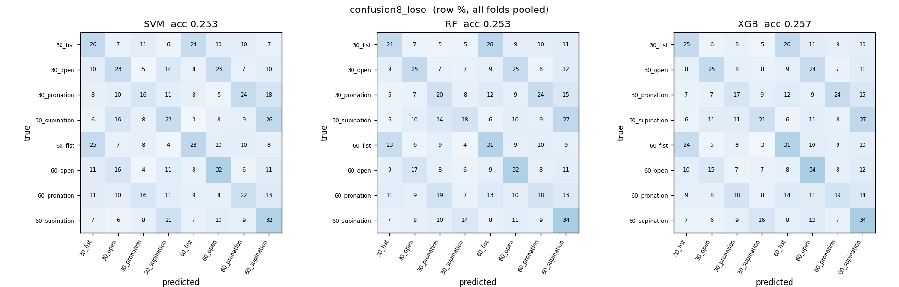
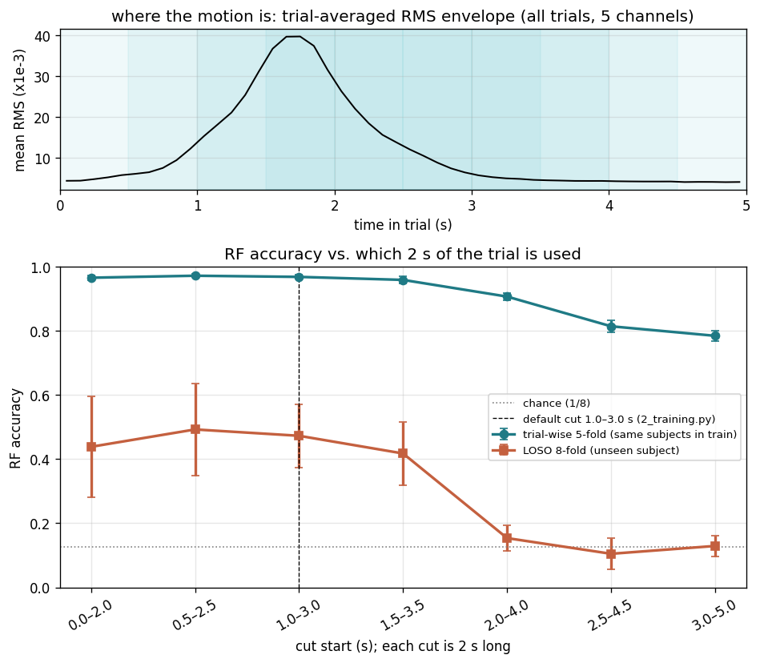

# sEMG 기반 손동작·팔꿈치 각도 동시 분류 — 논문 재현 및 SVM · RF · XGBoost 비교

대구가톨릭대학교 「딥러닝프로그래밍」 Step 2 과제 (20118701 신재윤)

- 재현 대상 논문: Lee, S., Kim, J., & Choi, S.-I. (2026). *Simultaneous classification of hand gestures and elbow angles using sEMG signals: a comparison of machine learning performances.* Biomedical Engineering Letters. https://doi.org/10.1007/s13534-026-00607-7
- 데이터: [TestUser-alt-dev/sEMG-Hand-Gesture-Elbow-Angle-Dataset](https://github.com/TestUser-alt-dev/sEMG-Hand-Gesture-Elbow-Angle-Dataset) (논문 공개 데이터, 피험자 8명 × 4동작 × 2각도 × 30회)

## 한눈에 보는 결과

| 항목 | 논문 | 본 재현 |
|---|---|---|
| 5-fold 교차검증 정확도 (trial-wise, RF) | 96.72 ± 0.58% | **96.82 ± 0.77%** |
| 〃 SVM | 95.83 ± 0.79% | **97.55 ± 0.70%** |
| 〃 XGBoost | 96.15 ± 0.56% | **96.72 ± 0.39%** |
| 세 모델 간 대응표본 t-검정 | 세 쌍 모두 유의하지 않음 | **세 쌍 모두 유의하지 않음** (p = 0.09 ~ 0.59) |
| 주요 오류 | 같은 동작의 두 각도 간 혼동 | **같은 결과** (RF 오류 61건 중 49건 = 80%, 최대 쌍 30°↔60° pronation 12건씩) |
| 학습 시간 RF / SVM / XGBoost | 0.31 / 0.33 / 19.8 s | 0.14 / 0.12 / 7.3 s (Apple M4, 환경이 달라 순서만 비교) |
| 추론 시간 (ms/표본) RF / SVM / XGBoost | 0.036 / 0.382 / 0.031 | 0.034 / 0.162 / 0.007 (SVM이 가장 느린 것은 같음) |
| **LOSO** (처음 보는 피험자, 논문은 후속 과제로만 언급) | – | **SVM 51.9 ± 12.5%, RF 47.2 ± 10.5%, XGBoost 46.2 ± 11.5%** |
| LOSO를 동작 4종 / 각도 2종으로 나눠 채점 (RF) | – | 동작 **0.75** (우연 0.25) / 각도 **0.60** (우연 0.5) |
| 동작이 없는 휴식 구간(3~5 s)만으로 분류 (RF) | – | trial-wise **78.5%** / LOSO 12.9% (우연 12.5%) → 세션 서명만으로도 trial-wise 78%가 나온다 |

용어: **trial-wise** = 시행 단위로 섞어 나눠 같은 사람의 다른 시행을 맞히는 평가(논문 방식). **LOSO** = 피험자 한 명을 통째로 빼고 학습해 처음 보는 사람을 맞히는 평가.

Step 2 제출물과 3주차 리포트 7개 항목이 이 README의 어디에 있는지:

| 제출물 | 위치 |
|---|---|
| ② 성능 비교표 (세 모델 × 네 지표) | 2.1 |
| ③ 교차검증 결과 (fold별 값 + 평균 ± 표준편차) | 2.2 |
| ④ 통계 검정 (세 쌍의 p값과 해석) | 2.3 |
| ⑤ 혼동행렬 + 오류 구조 해석 | 3 |
| ⑥ 계산 비용 (학습·추론 시간) | 2.4 |
| ⑦ 한계 (trial-wise 분할 문제 포함) | 4 한계 |

| 리포트 항목 | 위치 |
|---|---|
| 1. 문제 정의 | 1.1 |
| 2. 데이터 (출처·규모·분할·전처리) | 1.2 |
| 3. 방법 (특징·표본 구성·모델·검증) | 1.2 ~ 1.4 |
| 4. 결과 | 2 |
| 5. 오류 분석 | 3 |
| 6. 한계 | 4 |
| 7. 재현 정보 (환경·시드·실행 순서) | 1.5, 5 |

---

## 1. 코드 설명

### 1.1 문제 정의

팔의 근육 5곳(요측수근신근, 총지신근, 천지굴근, 상완이두근, 상완삼두근)에서 잰 표면 근전도(sEMG) 신호만으로 **손동작 4종(주먹, 펴기, 회내, 회외)과 팔꿈치 각도 2종(30°, 60°)을 동시에** 맞히는 **8클래스 분류** 문제다. 입력은 한 시행(5초 중 동작 구간 2초)의 특징 벡터, 출력은 `각도_동작` 8종 중 하나다. 성공 기준은 논문의 5-fold 교차검증 정확도 RF 96.72 ± 0.58%와 "세 모델 간 차이는 유의하지 않다"는 결론이다.

- **왜 동시 분류인가**: 기존 HMI는 동작 인식과 관절 각도 추정을 따로 하거나 IMU 같은 센서를 더 붙인다. 논문은 sEMG 하나로 둘을 한 번에 풀 수 있는지를 가벼운 머신러닝 모델로 확인하려 했다.
- **이 과제에서 더 한 것**: 논문의 평가(trial-wise, 같은 사람의 다른 시행을 맞힘)에 더해, 논문이 4절에서 후속 과제로 제안한 **LOSO**(Leave-One-Subject-Out, 처음 보는 사람을 맞힘)를 같은 코드로 돌려 두 결과를 나란히 비교했다.

### 1.2 사용한 데이터 및 전처리

- **규모**: 피험자 8명(a~h) × 4동작 × 2각도 = CSV 64개. 파일 하나에 같은 조건의 시행 30회가 이어서 기록되어 있고(`mark=1`이 시행 시작), 시행 하나는 5초 × 1000 Hz × 5채널이다. 총 **1920시행**. 각 CSV는 한 조건을 한 번에 녹음한 **별도 세션**이다(4절 한계 2와 관련).
- **시행 구조와 세그먼트 시작점**: 프로토콜은 휴식 2초 → 동작 1초 → 휴식 2초이고, 논문은 "2초 세그먼트"를 쓴다고만 밝히고 시작점은 명시하지 않는다(강의 실습 코드는 1.5초를 가정하되 "논문 설정이 아님"이라고 적어 두었다). 그래서 1주차에 시행 전체의 근활성을 직접 그려 동작이 실제로 언제 일어나는지 확인했다.

  

  동작별 평균 RMS(휴식 대비 배수, 중앙값)를 채널마다 그린 것이고, 빨간 영역이 프로토콜상 동작 구간 2~3초다. 실제 근활성은 **1.0초쯤 오르기 시작해 1.5~1.8초에 정점**을 찍고 3초 전에 휴식 수준으로 돌아온다. 프로토콜 기준보다 약 1초 앞서 있는데, 참가자가 박자보다 먼저 움직였거나 `mark`가 찍힌 시점이 프로토콜의 시작과 다를 수 있다. 프로토콜대로 2~3초를 자르면 정점을 놓치고 하강 구간만 남으므로, 상승·정점·하강을 모두 덮도록 **1.0~3.0초**를 세그먼트로 정했다. 시작점을 1.5초로 바꾸면 세 모델의 정확도가 1~2%p 내려간다(4절 "논문과 다르게 나온 점").
- **전처리 순서** (각 시행 안에서만 수행, `scripts/1_preprocessing.py`):
  1. 60 Hz notch → 20~450 Hz 4차 Butterworth band-pass (`filtfilt`). CSV 열 이름이 `bandpass 1~5`로 이미 같은 필터가 걸려 있어 한 번 더 거는 효과는 미미하다(`figures/week_2/filter_spectrum.png`).
  2. 2초(2000샘플) 자르기 → 200 ms 창, 100 ms 간격(50% overlap) → 시행당 **19개 창**
  3. 창마다 시간영역 특징 5종(RMS, MAV, WL, ZC, SSC) × 5채널 = **25차원**
- **표본 구성 = 시행 하나** (`scripts/loso.py`의 `load_dataset`): 창 19개의 25차원을 순서대로 이어 붙여 **475차원** 벡터 하나로 만든다. 그래서 표본 수는 **1920개 = 논문 Table 1의 학습 1536 + 테스트 384**와 같다. 논문은 "세그먼트마다 특징 벡터 19개"라고만 적고 입력 표본을 어떻게 구성했는지는 밝히지 않았는데, Table 1의 데이터 수와 Table 5의 학습 시간(SVM 0.33 s, RF 0.31 s)이 이 구성과 맞았다.
- **분할** (`scripts/loso.py`, 두 방식 모두 fold 안에서 학습 쪽 통계로만 `StandardScaler`를 `fit`):
  - **trial-wise 5-fold** (논문 방식): 시행 1920개를 `StratifiedKFold(5, shuffle=True, random_state=42)`로 나눈다. 층화 기준은 **피험자 × 라벨 64칸**이라 fold마다 칸당 정확히 6시행이 테스트에 들어간다(라벨로만 층화하면 피험자별 36~60개로 흔들렸다). 같은 사람의 다른 시행이 학습에 있다.
  - **LOSO 8-fold**: `LeaveOneGroupOut(groups=subject)`. 테스트 피험자는 학습에 전혀 없다.
  - 한 시행의 창 19개는 한 벡터로 묶여 있으므로 창 수준 누수는 구조적으로 불가능하다. 표준화를 fold 안에서 하므로 테스트 통계도 새지 않는다.
- 논문과 다르게 둔 것: 세그먼트 시작점 1.0 s(논문 미명시), 표본 구성(Table 1에서 추론), hold-out 80/20은 따로 돌리지 않고 5-fold 평균으로 대신함.

### 1.3 사용한 모델

세 모델의 설정은 논문 2.4절 값을 그대로 썼다(`scripts/2_training.py` 상단 전역 변수). 논문처럼 SVM·RF는 기본값, XGBoost만 논문의 예비 튜닝값이다.

| 모델 | 설정 | 논문과 |
|---|---|---|
| SVM | `SVC(kernel='rbf', C=1.0, gamma='scale', decision_function_shape='ovr')` | 동일 |
| RF | `RandomForestClassifier(n_estimators=100, n_jobs=-1, random_state=42)` | 동일 |
| XGBoost | `XGBClassifier(n_estimators=400, max_depth=6, learning_rate=0.05, subsample=0.9, colsample_bytree=0.8, reg_lambda=1.0, tree_method='hist', random_state=42)` | 동일 |

하이퍼파라미터를 바꾸지 않은 근거로 RF의 검증 곡선을 따로 그렸다(`scripts/3_rf_validation.py`, 2.5절). 검증 데이터는 외부 fold의 **학습 쪽 안에서** 다시 뗐으므로 테스트 fold는 보지 않았다.

### 1.4 학습 및 테스트 방법

세 모델이 **완전히 같은 조건**이 되도록 `2_training.py`의 fold 반복문 안에서 세 모델을 차례로 학습한다. fold마다 `clone()`으로 새 모델을 만들고, 같은 `Xtr/Xte`와 같은 표준화 통계를 받는다.

| 설정 | 값 |
|---|---|
| 표본 | 시행 1920개 × 475차원 (1.2절) |
| 분할 | `--split trialwise` (5-fold, 논문) 또는 `--split loso` (8-fold) |
| 지표 | Accuracy, macro Precision / Recall / F1 (macro는 실습 선택. 8클래스가 완전 균형이라 micro 평균과 거의 같다) |
| 교차검증 보고 | fold별 값 + 평균 ± 표준편차(`np.std`, 모표준편차) |
| 통계 검정 | fold별 정확도를 같은 fold끼리 짝지은 대응표본 t-검정(`scipy.stats.ttest_rel`), 세 쌍, α = 0.05 |
| 혼동행렬 | 전체 fold의 예측을 합쳐 8×8, 행 기준 % |
| 계산 비용 | fold별 `fit` 시간, 테스트셋 일괄 `predict` 시간 ÷ 표본 수 (처리량 기준) |
| Seed | 분할 42, 모델 42 |

추론 시간은 강의 예시(표본 1개를 100번 예측)가 아니라 일괄 예측 ÷ 표본 수로 쟀다. `n_jobs=-1`인 RF는 `predict` 호출마다 스레드를 띄우는 고정 비용이 있어 1개씩 재면 SVM보다 10배 느리게 나오는데, 이는 모델 비용이 아니다.

### 1.5 실행 방법

```bash
# 0) 환경 (Python 3.12. GPU 불필요)
python -m venv .venv && source .venv/bin/activate     # Windows: .venv\Scripts\activate
pip install -r requirements.txt

# 1) 데이터 받기 (저장소 루트에 data/ 로. CSV는 data/data/ 아래)
git clone https://github.com/TestUser-alt-dev/sEMG-Hand-Gesture-Elbow-Angle-Dataset.git data

# 2) 전처리 · 특징 추출 → outputs/dataset.npz  (약 20초)
python scripts/1_preprocessing.py

# 3) 세 모델 학습·평가·검정 (②③④⑤⑥) → outputs/week_3/{split}/, figures/week_3/confusion8_{split}.png
python scripts/2_training.py --split trialwise      # 논문 방식 5-fold  (약 1분)
python scripts/2_training.py --split loso           # LOSO 8-fold      (약 1분)

# 4) RF 검증 곡선 (트리 수 · 깊이) → outputs/week_3/{split}/rf_val_*.csv, figures/week_3/rf_val_{split}.png
python scripts/3_rf_validation.py --split trialwise # 각 30초
python scripts/3_rf_validation.py --split loso

# 5) cut 위치 실험 (한계 ⑦의 근거) → outputs/week_3/cut_sweep.csv, figures/week_3/cut_sweep.png  (약 1.5분)
python scripts/4_cut_sweep.py

# 6) (선택) 세그먼트 시작점 1.5 s 비교 (4절 "논문과 다르게 나온 점") → outputs/week_3_start1.5/
python scripts/1_preprocessing.py --start 1.5 --out outputs/week_3_start1.5/dataset_start1.5.npz
python scripts/2_training.py --data outputs/week_3_start1.5/dataset_start1.5.npz --split trialwise --out outputs/week_3_start1.5 --fig-suffix _start1.5
```

`scripts/data.py`와 `scripts/loso.py`는 위 스크립트가 import하는 모듈이다. 직접 실행하면 시행 수, fold별 표본 수, 표준화 확인만 출력한다. 각 스크립트의 흐름도와 실제 데이터 예시 표는 `mermaid/`에 있다.

### 1.6 코드 파일 설명

| 파일 | 설명 |
|---|---|
| `scripts/data.py` | CSV 64개를 `mark` 기준으로 5초 시행 1920개로 자른다 (`load_trials`). [mermaid/data.md](mermaid/data.md) |
| `scripts/1_preprocessing.py` | 필터 → 2초 자르기 → 200 ms 창 → 25차원 특징. 창 단위 배열을 `outputs/dataset.npz`로 저장 (분할·표준화 없음). [mermaid/preprocessing.md](mermaid/preprocessing.md) |
| `scripts/loso.py` | **시행 단위 표본 구성**(`load_dataset`, 창 19개 → 475차원), 분할 생성기 두 개(`loso_folds`, `trialwise_folds`), fold 안 표준화. [mermaid/loso.md](mermaid/loso.md) |
| `scripts/2_training.py` | SVM · RF · XGBoost를 같은 fold로 학습해 성능표 · fold별 정확도 · t-검정 · 혼동행렬 · 계산 비용을 만든다. 하이퍼파라미터는 상단 전역 변수. [mermaid/training.md](mermaid/training.md) |
| `scripts/3_rf_validation.py` | 학습 fold 안에서 검증을 떼어 RF의 트리 수·깊이별 검증 정확도 곡선 (fold 평균 ± 표준편차). [mermaid/rf_validation.md](mermaid/rf_validation.md) |
| `scripts/4_cut_sweep.py` | 세그먼트 시작점을 0~3 s로 옮겨 가며 trial-wise·LOSO 정확도를 재서 "동작을 보는가, 세션 잡음을 보는가"를 확인. [mermaid/cut_sweep.md](mermaid/cut_sweep.md) |
| `outputs/dataset.npz` | 창 단위 특징 (36480 × 25) + 라벨 · 피험자 · 시행 번호 |
| `outputs/week_3/{trialwise,loso}/` | `scores.csv`(fold × 모델 지표), `preds.csv`(표본별 예측), `ttest.csv`, `rf_val_trees.csv`, `rf_val_depth.csv` |
| `outputs/week_3/cut_sweep.csv` | cut 시작점별 정확도 |
| `outputs/week_3_start1.5/` | 세그먼트 시작점 1.5 s로 만든 데이터셋과 trial-wise 결과 (4절 비교표) |
| `figures/week_1/`, `figures/week_2/` | 1·2주차 실습 그림 (원신호, 동작 구간 타이밍, 필터 스펙트럼, cut 확인) |
| `figures/week_3/` | `confusion8_{split}.png`, `rf_val_{split}.png`, `cut_sweep.png` |
| `report/week_2.pdf` | 2주차 제출 리포트 |
| `mermaid/` | 스크립트별 Mermaid 흐름도 + 실제 값으로 만든 데이터 예시 표 + 결과 해석 |

---

## 2. 모델 성능 비교

### 2.1 성능 비교표 (제출물 ②)

fold 평균 ± 표준편차. Precision, Recall, F1은 macro 평균이다. 논문의 hold-out 표(Table 2)는 한 번 나눈 결과이므로, 여기서는 5-fold 평균으로 대신한다.

**trial-wise 5-fold (논문 방식)**

| Model | Accuracy | Precision | Recall | F1 | 논문 Table 3 (Accuracy) |
|---|---|---|---|---|---|
| SVM | **97.55 ± 0.70%** | 97.61% | 97.55% | 97.55% | 95.83 ± 0.79% |
| RF | 96.82 ± 0.77% | 96.90% | 96.82% | 96.82% | 96.72 ± 0.58% |
| XGBoost | 96.72 ± 0.39% | 96.80% | 96.72% | 96.72% | 96.15 ± 0.56% |

**LOSO 8-fold (처음 보는 피험자)**

| Model | Accuracy | Precision | Recall | F1 |
|---|---|---|---|---|
| SVM | **51.93 ± 12.49%** | 54.14% | 51.93% | 48.55% |
| RF | 47.24 ± 10.50% | 48.84% | 47.24% | 42.33% |
| XGBoost | 46.20 ± 11.51% | 46.92% | 46.20% | 41.63% |

- trial-wise에서는 세 모델 모두 96~98%로 논문과 같은 수준이다. RF(96.82%)와 XGBoost(96.72%)는 논문 값과 0.1~0.6%p 차이이고 SVM만 1.7%p 높다. 순위는 논문 RF > XGBoost > SVM, 여기서는 SVM > RF > XGBoost로 다르지만 차이는 1%p 안쪽이다(2.3절).
- LOSO에서는 모든 모델이 절반 수준으로 떨어진다. 8클래스 우연 수준(12.5%)의 4배이지만 trial-wise와는 체급이 다르다. 이 차이가 이 과제의 핵심 결과다(4절).

### 2.2 교차검증 결과 (제출물 ③)

| trial-wise fold | SVM | RF | XGBoost | | LOSO 테스트 피험자 | SVM | RF | XGBoost |
|---|---|---|---|---|---|---|---|---|
| fold1 | 96.88% | 97.40% | 97.14% | | a | 69.17% | 52.92% | 49.58% |
| fold2 | 98.18% | 97.40% | 96.88% | | b | 52.50% | 52.92% | 45.83% |
| fold3 | 97.14% | 97.14% | 96.88% | | c | 55.42% | 54.58% | 62.08% |
| fold4 | 97.14% | 95.57% | 96.09% | | d | 47.08% | 30.42% | 27.08% |
| fold5 | 98.44% | 96.61% | 96.61% | | e | 67.08% | 55.00% | 55.83% |
| | | | | | f | 30.00% | 39.17% | 35.00% |
| | | | | | g | 46.25% | 35.42% | 40.83% |
| | | | | | h | 47.92% | 57.50% | 53.33% |
| **평균 ± 표준편차** | **97.55 ± 0.70%** | **96.82 ± 0.77%** | **96.72 ± 0.39%** | | | **51.93 ± 12.49%** | **47.24 ± 10.50%** | **46.20 ± 11.51%** |

- trial-wise는 fold 간 표준편차가 0.4~0.8%p로 논문(0.56~0.79%p)과 같은 수준이다. fold마다 피험자 × 클래스 칸당 6시행씩 정확히 같은 구성이라 분할 운이 끼어들 여지가 적다.
- LOSO는 표준편차가 10~12%p로 매우 크다. 피험자 a·e는 67~69%(SVM)인데 f는 30%다. "LOSO 50%"라는 평균 하나로는 절반만 말한 것이고, 사람에 따라 이 특징이 통하는 정도가 크게 다르다.

### 2.3 통계 검정 (제출물 ④)

fold별 정확도를 같은 fold끼리 짝지은 대응표본 t-검정. trial-wise는 자유도 4, LOSO는 자유도 7.

| 분할 | 쌍 | 평균 차 | t | p | 판정 |
|---|---|---|---|---|---|
| trial-wise | SVM vs RF | +0.73%p | 1.63 | 0.178 | 유의하지 않음 |
| trial-wise | SVM vs XGBoost | +0.83%p | 2.24 | 0.089 | 유의하지 않음 |
| trial-wise | RF vs XGBoost | +0.10%p | 0.59 | 0.587 | 유의하지 않음 |
| LOSO | SVM vs RF | +4.69%p | 1.24 | 0.257 | 유의하지 않음 |
| LOSO | SVM vs XGBoost | +5.73%p | 1.50 | 0.178 | 유의하지 않음 |
| LOSO | RF vs XGBoost | +1.04%p | 0.57 | 0.584 | 유의하지 않음 |

- **여섯 쌍 모두 p ≥ 0.05로, 세 모델 간 차이를 주장할 수 없다.** 논문의 결론("RF가 1위였지만 세 모델 간 차이는 유의하지 않았다")과 같다. 수치가 가장 높은 모델이 더 좋은 모델이라고 말할 수 없다는 뜻이며, p ≥ 0.05는 "차이를 검출하지 못함"이지 "같다"는 증거가 아니다.
- trial-wise에서 SVM이 0.7~0.8%p 높은 것은 자유도 4의 작은 표본에서 유의에 이르지 못한다(SVM vs XGBoost p = 0.089가 가장 가깝다). 참고로 라벨로만 층화한 초기 분할에서는 같은 비교가 p ≈ 0.03으로 유의하게 나왔다가, 피험자 × 라벨로 공평하게 나누자 사라졌다. fold 구성이 조금만 달라져도 뒤집히는 수준의 차이다.
- LOSO에서는 평균 차가 5%p로 더 커도 fold 간 편차(±10~12%p)가 그보다 커서 역시 유의하지 않다. 모델을 바꿔서 얻을 수 있는 차이보다 "테스트 피험자가 누구냐"가 훨씬 큰 변수다.

### 2.4 계산 비용 (제출물 ⑥)

trial-wise fold 평균. Apple M4 (10코어), CPU만 사용. 학습셋 1536표본 × 475차원.

| Model | 학습 시간 | 추론 시간 (ms/표본) | 논문 Table 5 학습 / 추론 |
|---|---|---|---|
| SVM | 0.12 s | **0.162** | 0.334 s / **0.382 ms** |
| RF | 0.14 s | 0.034 | 0.313 s / 0.036 ms |
| XGBoost | **7.29 s** | 0.007 | **19.846 s** / 0.031 ms |

- 순서가 논문과 같다. 학습은 XGBoost가 가장 느리고(400 라운드 × 8클래스 트리), 추론은 SVM이 가장 느리다(서포트 벡터 수에 비례). 절댓값은 CPU가 달라 비교할 수 없지만 XGBoost / RF 학습 시간 비율은 논문 63배, 여기 52배로 비슷하다.
- 세 모델의 정확도가 유의하게 다르지 않으므로(2.3절), 모델 선택 기준은 이 표가 된다. 학습·추론이 모두 빠른 RF가 가장 균형 잡혀 있고, 실시간 사용(200 ms 창이 100 ms마다 하나)에는 세 모델 모두 여유가 있다.
- 측정 방식: 추론은 테스트셋 일괄 예측 시간 ÷ 표본 수(처리량 기준)라, 표본 하나를 넣었을 때의 지연보다 작게 나온다.

### 2.5 하이퍼파라미터를 바꾸지 않은 근거 — RF 검증 곡선




외부 fold의 학습 쪽 안에서 검증을 떼어(trial-wise: 학습 시행의 20%, LOSO: 학습 7명 중 1명) 트리 수 1~300과 `max_depth` 2~제한 없음에 대한 검증 정확도를 fold 평균 ± 표준편차로 그렸다. RF는 손실을 줄여 가는 과정이 없으므로 딥러닝의 epoch 곡선 대신 트리 수가 "학습 과정"에 해당한다.

| 분할 | 트리 1 → 20 → 100 → 300 | 깊이 2 → 8 → 20 → 제한 없음 |
|---|---|---|
| trial-wise | 0.687 → 0.948 → 0.962 → 0.964 | 0.519 → 0.944 → 0.961 → 0.962 |
| LOSO | 0.329 → 0.438 → 0.459 → 0.466 | 0.344 → 0.459 → 0.457 → 0.459 |

- trial-wise는 트리 85개 근처에서 포화하고 깊이 10 이상에서 차이가 0.2%p 안이다. 논문 설정(100개, 제한 없음)을 바꿀 이유가 없다.
- LOSO는 어떤 설정으로도 0.44~0.47 사이에서 움직이고, 그 폭(0.03)이 fold 간 편차(±0.11)의 4분의 1이다. 모델 설정으로 LOSO 성능을 끌어올릴 여지가 없다는 뜻이고, 천장은 모델이 아니라 데이터·특징 쪽에 있다.

---

## 3. Confusion Matrix 분석 (제출물 ⑤)

행 = 실제(true), 열 = 예측(predicted), 칸 = 행 기준 %. 전체 fold의 예측을 합쳐 그렸다. 라벨은 `각도_동작`이며 행·열 순서가 30° 4종 → 60° 4종이라, **대각선에서 4칸 떨어진 칸이 "같은 동작, 다른 각도"** 오류다.

### trial-wise (논문 방식)



클래스별 재현율 (%):

| 클래스 | SVM | RF | XGBoost |
|---|---|---|---|
| 30_fist | 99.2 | 98.3 | 97.5 |
| 30_open | 98.3 | 97.5 | 95.8 |
| 30_pronation | 95.4 | **93.8** | 94.6 |
| 30_supination | 96.2 | 96.7 | 97.1 |
| 60_fist | 98.8 | 97.9 | 97.1 |
| 60_open | 98.8 | 97.9 | 99.2 |
| 60_pronation | 96.7 | **94.2** | 95.4 |
| 60_supination | 97.1 | 98.3 | 97.1 |

- **가장 잘 분류된 클래스**: 30_fist (SVM 99.2%, RF 98.3%). 동작 구간의 채널별 평균 RMS를 보면 주먹은 요측수근신근이 다른 동작의 1.7~2.7배(28.8 vs 10.7~17.0 ×10⁻³)로 켜지고 손가락 신근·굴근도 함께 커서 근육 조합이 가장 뚜렷하다.
- **가장 많이 오분류된 클래스**: 30_pronation · 60_pronation (RF 93.8 / 94.2%).
- **주요 오분류 유형**: **같은 동작의 다른 각도** 사이. RF 오류 61건 중 49건(80%)이 이 유형이고, 최대 오류 쌍은 30_pronation ↔ 60_pronation 12건씩이다. SVM도 47건 중 33건(70%), XGBoost도 63건 중 46건(73%)이다. 다른 동작끼리 틀린 경우는 61건 중 12건뿐이고 그마저 같은 각도 안의 pronation ↔ supination(2건씩)이 대부분이다.
- **오분류가 발생한 이유**: 논문 3.5절의 설명과 같다. 동작을 바꾸면 어느 근육이 켜지는지가 달라져 시간영역 특징(RMS, MAV 등)에 크게 반영되지만, 같은 동작에서 팔꿈치 각도만 바꾸면 상완이두근·삼두근의 활성 크기가 조금 달라질 뿐이다. 회내가 가장 약한 것도 논문과 같다. 회내는 전완 근육의 미세한 협응으로 이루어져 각도에 따른 진폭 변화가 작다.

### LOSO (처음 보는 피험자)



클래스별 재현율 (%):

| 클래스 | SVM | RF | XGBoost |
|---|---|---|---|
| 30_fist | 37.1 | **27.5** | 28.8 |
| 30_open | 47.5 | **27.9** | 29.6 |
| 30_pronation | 47.5 | 63.8 | 68.8 |
| 30_supination | 64.2 | 52.1 | 51.7 |
| 60_fist | 60.0 | 48.3 | 32.9 |
| 60_open | 59.6 | 50.0 | 45.8 |
| 60_pronation | 45.0 | 42.9 | 43.3 |
| 60_supination | 54.6 | 65.4 | 68.8 |

- **가장 잘 분류된 클래스**: 60_supination (RF 65.4%), 30_pronation (RF 63.8%). 회외는 상완이두근이 유일하게 크게 켜지는 동작이고(평균 RMS 27.5 vs 다른 동작 13~16 ×10⁻³), 회내·회외는 전완을 비트는 동작이라 근육 조합이 주먹·펴기와 가장 다르다.
- **가장 많이 오분류된 클래스**: 30_fist (RF 27.5%), 30_open (27.9%).
- **주요 오분류 유형**: 역시 **같은 동작의 다른 각도**이고, 비율이 훨씬 크다. RF 최대 오류 쌍은 30_open → 60_open **105건**(240건 중 44%), 30_supination → 60_supination 82건, 60_open → 30_open 78건이다. 오류 1013건 중 534건(53%)이 각도 혼동이고, 나머지는 동작까지 다른 혼동(30_open → 60_fist 34건, 60_fist → 60_pronation 34건, 30_fist → 60_pronation 28건 등)으로 특정 쌍에 몰리지 않고 흩어져 있다. trial-wise에서는 동작 간 혼동이 12건뿐이었다.
- **오분류가 발생한 이유**: 8클래스 예측을 동작 4종과 각도 2종으로 따로 채점하면 분명해진다(RF 기준).

  | 채점 단위 | trial-wise | LOSO | 우연 수준 |
  |---|---|---|---|
  | 8클래스 | 96.8% | 47.2% | 12.5% |
  | 동작 4종만 (각도 무시) | 99.2% | **75.1%** | 25% |
  | 각도 2종만 (동작 무시) | 97.3% | **59.5%** | 50% |

  처음 보는 사람의 **동작은 75%로 맞히지만 각도는 우연(50%)에 가까운 60%**다. trial-wise에서는 같은 사람의 시행이 학습에 있어 "이 사람은 60°일 때 이두근이 이만큼 더 켜진다"를 외울 수 있지만, 각도에 따른 근활성 차이의 크기와 방향은 사람마다 달라서 다른 사람의 패턴으로는 맞히지 못한다. 논문이 trial-wise에서 "상대적으로 어렵다"고 본 각도 구별이 LOSO에서는 거의 불가능한 수준이 된다.
- **피험자별 편차**: RF 기준 h 57.5%, e 55.0%, c 54.6% ~ d 30.4%, g 35.4%, f 39.2%. `python scripts/loso.py`가 출력하는 "테스트 피험자의 특징 평균이 학습 7명 기준에서 몇 표준편차 떨어졌나"를 보면 f가 3.95로 가장 멀고 성능도 가장 낮은 축이다. 그러나 c는 2.45로 두 번째로 멀어도 54.6%라, 분포 거리만으로 피험자별 성능을 설명할 수는 없다.

---

## 4. 최종 결과

- **논문 재현**: trial-wise 5-fold에서 RF 96.82 ± 0.77%(논문 96.72 ± 0.58%), XGBoost 96.72%, SVM 97.55%. 세 모델 간 차이는 유의하지 않고(p = 0.09~0.59), 주 오류는 같은 동작의 두 각도 간 혼동(80%)이며, 학습은 XGBoost가, 추론은 SVM이 가장 느리다. **논문의 수치와 세 가지 결론이 모두 재현됐다.**
- **가장 성능이 좋은 모델**: 두 분할 모두 SVM이 평균 1위(trial-wise 97.55%, LOSO 51.93%)이지만 어느 쌍도 유의하지 않다. 정확도로는 세 모델을 가를 수 없고, 학습·추론이 모두 빠른 RF가 비용 면에서 가장 균형 잡혀 있다.
- **처음 보는 사람에 대한 성능 (LOSO)**: 46~52%. 동작 4종은 75%로 맞히지만 각도 2종은 60%로 우연에 가깝다. 피험자에 따라 30~69%로 편차가 매우 크다.

### 논문과 다르게 나온 점과 그 이유

1. **모델 순위와 SVM의 1.7%p 차이 — 세그먼트 시작점 때문으로 보인다.** 논문은 RF > XGBoost > SVM, 여기서는 SVM > RF > XGBoost다. 차이는 0.1~0.8%p로 모두 비유의이지만, SVM만 논문보다 1.7%p 높다. 논문도 SVM은 기본값을 썼으므로 설정 차이는 아니다. 논문이 명시하지 않은 세그먼트 시작점을 강의 실습 가정인 1.5초로 바꿔 같은 파이프라인을 돌려 보면(`1_preprocessing.py --start 1.5`로 만든 데이터셋에 `2_training.py --split trialwise`, 결과는 `outputs/week_3_start1.5/`):

   | 세그먼트 | SVM | RF | XGBoost | 순위 |
   |---|---|---|---|---|
   | 1.0~3.0 s (본 재현, 2.1절) | 97.55 ± 0.70% | 96.82 ± 0.77% | 96.72 ± 0.39% | SVM > RF > XGB |
   | 1.5~3.5 s | 95.26 ± 0.67% | 95.94 ± 1.16% | 94.69 ± 1.13% | RF > SVM > XGB |
   | 논문 Table 3 | 95.83 ± 0.79% | 96.72 ± 0.58% | 96.15 ± 0.56% | RF > XGB > SVM |

   시작점을 0.5초 늦추면 SVM이 논문 값 근처(95.3%)로 내려오고 RF가 1위가 되어 순위가 논문 쪽으로 바뀐다. 다만 RF와 XGBoost는 논문보다 0.8~1.5%p 낮아지므로, 시작점 하나로 세 값을 동시에 맞출 수는 없다. 1.0초 시작은 동작의 상승 구간(1.0~1.5초)을 포함하고, 1.5초 시작은 그 구간을 버리는 대신 휴식이 더 들어간다. 즉 시작점 하나가 세 모델을 1~2%p씩 움직이고 그 크기가 논문과의 차이와 같은 수준이다. 논문의 실제 시작점은 알 수 없으므로 단정은 못 하지만, SVM의 차이와 순위 역전의 가장 유력한 원인이다. 어느 시작점에서든 세 모델 차이는 비유의다.
2. **trial-wise 점수에 세션 서명이 섞여 있다**: 아래 실험 참고.



세그먼트 시작점을 0~3 s로 옮겨 가며 같은 특징·같은 RF로 두 분할을 평가했다(`scripts/4_cut_sweep.py`). 위 패널은 시행 평균 RMS 포락선으로 동작이 1.0~2.7 s에 있음을 보여 준다.

| 구간 | 내용 | 구간 RMS (×10⁻³) | trial-wise | LOSO |
|---|---|---|---|---|
| 1.0~3.0 s | 동작 (기본) | 40.5 | 96.9% | 47.3% |
| 2.0~4.0 s | 동작 끝 + 휴식 | 18.5 | 90.7% | 15.4% |
| **3.0~5.0 s** | **휴식 (근육 활동 없음)** | 6.3 | **78.5%** | **12.9%** (우연 12.5%) |

아무 동작도 없는 휴식 2초만으로 trial-wise는 78.5%를 맞힌다. 이 데이터는 피험자 × 클래스마다 CSV 파일 하나가 **별도 세션**으로 기록되어 파일마다 휴식 시 잡음 수준이 다르다(예: 피험자 a의 3번 채널 휴식 RMS가 fist 파일 15, supination 파일 3~4 ×10⁻³). 같은 사람의 같은 파일이 학습에 있으면 "어느 파일에서 온 시행인가"로 클래스를 맞힐 수 있고, 이 서명은 동작이 없을 때 가장 깨끗하다. LOSO에서는 다른 사람의 파일 서명이 쓸모없으므로 휴식 구간에서 우연으로 떨어지고, 동작 구간에서만 우연을 넘는다. 즉 **세션 서명만으로도 78%까지 나오므로, 논문 방식의 96.8% 중 동작 정보가 더해 주는 몫은 많아야 18%p다.** 동작 정보만으로 처음 보는 사람을 맞히면 47%다.

### 한계

1. **trial-wise 분할은 처음 보는 사람에 대한 성능이 아니다.** 논문도 4절에서 "같은 참가자의 샘플이 학습과 테스트 양쪽에 들어가므로 보고된 성능은 수집된 데이터셋 안에서의 성능이지 피험자 독립 일반화가 아니며, 후속 연구는 LOSO를 써야 한다"고 밝혔다. 이 과제의 LOSO 결과(46~52%)와 cut 실험(휴식 구간만으로 78.5%)은 그 한계가 "조금 낙관적인 숫자" 수준이 아니라 "근육 활동 없이도 나오는 숫자"임을 보여 준다. 사용자마다 보정 세션을 거치는 제품이라면 trial-wise가 현실적인 평가이지만, 보정 없이 아무에게나 쓰려면 LOSO가 맞는 평가다.
2. **데이터 수집 설계가 세션 서명과 클래스를 묶어 놓았다.** 클래스마다 파일(세션)을 따로 녹음했기 때문에 전극 상태·잡음 수준이 클래스의 단서가 된다. 여덟 클래스를 한 세션에서 섞어 기록했다면 trial-wise도 동작 정보만 재는 평가가 됐을 것이다. 이 문제는 모델이나 분할로는 풀 수 없다.
3. **피험자 8명, LOSO fold 편차 ±10~12%p.** 피험자별 30~69%로 흔들려 평균 하나로 일반화 성능을 말하기 어렵고, 세 모델 비교도 이 편차에 묻힌다. 더 많은 피험자와 세션이 필요하다.
4. **각도 정보가 피험자 의존적이다.** 처음 보는 사람의 각도는 60%(우연 50%)밖에 못 맞힌다. 시간영역 특징 5종은 각도에 따른 미세한 근활성 차이를 사람 간에 공통된 방식으로 담지 못한다. 논문이 제안한 주파수 영역 특징, 또는 시행 안 휴식 구간을 기준으로 한 정규화나 테스트 피험자의 소수 시행으로 보정하는 방식을 시험해야 하는데, 이번 과제에서는 하지 않았다.
5. **논문 설정 중 추론한 것이 있다.** 세그먼트 시작점(1.0 s)은 1주차 동작 구간 분석으로, 표본 구성(창 19개 이어 붙임)은 Table 1·5의 숫자로 정했다. 둘 다 논문에 명시되지 않았고, 시작점은 0.5초만 달라져도 정확도가 1~2%p 움직인다. hold-out 80/20은 따로 돌리지 않고 5-fold 평균으로 대신했고, 추론 시간은 처리량 기준이라 논문의 측정 방식과 같은지 확인할 수 없다.
6. **하이퍼파라미터를 튜닝하지 않았다.** RF 검증 곡선으로 논문 설정이 타당함은 확인했지만 SVM의 C·gamma, XGBoost의 라운드 수는 곡선을 그리지 않았다. 세 모델 모두 논문 설정 그대로라 비교는 공정하지만, 각 모델의 최고 성능을 비교한 것은 아니다.
7. **통계 검정의 표본이 작다.** trial-wise는 fold 5개(자유도 4), LOSO는 8개(자유도 7)다. 교차검증 fold는 학습 데이터를 서로 공유하므로 독립 표본이 아니고, 비유의 결과는 "차이 없음"의 증거가 아니라 "검출 못 함"이다.

### 전체적인 실험 결과 및 느낀 점

논문의 수치는 재현됐다. 같은 전처리, 같은 특징, 같은 설정으로 trial-wise 5-fold를 돌리니 RF 96.8%로 논문의 96.7%와 같았고, 세 모델 간 차이가 유의하지 않다는 결론과 각도 간 혼동이 주 오류라는 관찰, 계산 비용의 순서까지 맞았다. 다만 논문이 명시하지 않은 것이 둘 있었다. 세그먼트의 시작점과 입력 표본의 구성이다. 시작점은 1주차에 RMS 포락선으로 동작 구간을 직접 찾아 정했고, 표본은 시행 하나(창 19개를 이어 붙인 475차원)로 두었는데 논문 Table 1의 데이터 수 1920과 Table 5의 학습 시간이 이 구성과 맞았다. 재현은 결과 표만 맞추는 일이 아니라 **논문의 모든 숫자를 하나씩 대조해 빈 곳을 채우는 일**이라는 것을 배웠다.

두 번째로 배운 것은 **같은 모델, 같은 데이터에서 평가 방식만 바꾸면 97%가 47%가 된다**는 것이다. 논문이 스스로 밝힌 한계이긴 하지만, 휴식 구간만으로 78%가 나오는 것을 직접 보고 나서야 그 한계가 얼마나 큰지 실감했다. 모델은 근육 활동 없이도 "어느 파일에서 왔나"로 대부분을 맞힐 수 있었고, 그 지름길은 데이터 수집 설계에서 이미 열려 있었다. 처음 보는 사람에게 동작은 통하지만 각도는 거의 통하지 않는다는 것도, LOSO를 돌리지 않았다면 "각도 구별이 상대적으로 어렵다" 정도로만 알고 지나갔을 것이다.

세 번째는 강의의 핵심 문장 "수치가 높다고 더 좋은 모델이라고 말할 수는 없다"를 두 번 겪은 것이다. 처음 라벨로만 층화한 분할에서는 SVM이 다른 둘보다 유의하게 높게 나왔는데, 피험자별로 공평하게 다시 나누자 유의성이 사라졌다. 또 LOSO에서 세 모델이 5%p까지 벌어져도 fold 편차가 그보다 커서 어느 쌍도 가를 수 없었다. 순위표의 1위보다 그 차이가 분할 하나 바뀌면 뒤집히는 크기인지가 훨씬 중요했고, 모델 선택은 결국 정확도가 아니라 계산 비용으로 하게 됐다.

---

## 5. 재현 정보

| 항목 | 값 |
|---|---|
| OS | macOS 26.6 (Apple M4, 10코어, GPU 불필요) |
| Python | 3.12.13 |
| 주요 패키지 | numpy 2.4.6, pandas 3.0.3, scipy 1.17.1, scikit-learn 1.8.0, xgboost 3.3.0, matplotlib 3.10.8 |
| Seed | 분할 42 (StratifiedKFold), 모델 42 (RF, XGBoost; SVM은 결정적) |
| 실행 순서 | 위 1.5절. 전체 약 6분 |

`outputs/`의 결과 파일(`dataset.npz` 6 MB, `preds.csv` 등)과 `figures/`는 저장소에 포함되어 있어 실행 없이도 표와 그림을 확인할 수 있다. 원본 CSV(`data/`)는 용량 때문에 제외했고 위 데이터셋 저장소를 클론하면 된다.
