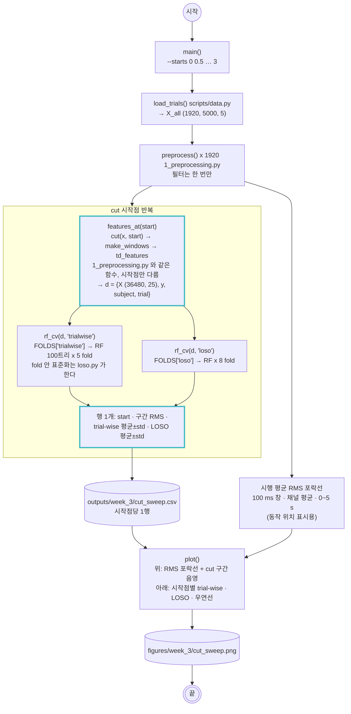

# scripts/4_cut_sweep.py — cut 위치 실험: 모델이 동작을 보는가, 파일별 잡음을 보는가

실행: `python scripts/4_cut_sweep.py [--starts 0 0.5 1 1.5 2 2.5 3]`

`1_preprocessing.py`의 cut 시작점(기본 1.0 s)을 0~3 s로 옮겨 가며 같은 창·특징을 메모리에서 다시 만들고, RF 하나로 trial-wise 5-fold와 LOSO 8-fold 정확도를 잰다. `dataset.npz`는 건드리지 않는다. 3주차 리포트에서 "trial-wise 점수는 근육 활동이 아니라 파일별 잡음 서명이다"를 보이는 핵심 실험이다.

## 그림에서 봐야 할 것

- **특징 함수는 1단계 것을 그대로 쓴다.** `cut()`의 시작점만 다르고 필터·창·특징은 같으므로, 점수 차이는 오직 "시행의 어느 2초를 보느냐"에서 온다.
- **분할과 표준화는 2단계와 같은 생성기를 쓴다.** 그래서 start 1.0 s 행의 값은 `2_training.py`의 RF 결과(trial-wise 0.605, LOSO 0.253)와 일치해야 하고, 실제로 일치한다.
- **RMS 포락선이 "동작이 어디 있는지"의 근거다.** 1주차에서 확인한 동작 구간 1.0~2.7 s가 포락선의 봉우리로 다시 보인다. 2.5 s 이후는 휴식이다.

## 결과 (2026-10-24, RF 100트리)

| cut 구간 | 내용 | 구간 RMS (x10⁻³) | trial-wise | LOSO |
|---|---|---|---|---|
| 0.0~2.0 s | 휴식 + 동작 앞부분 | 37.2 | 0.679 ± 0.015 | 0.227 ± 0.025 |
| 0.5~2.5 s | 동작 대부분 | 40.4 | 0.623 ± 0.008 | 0.252 ± 0.027 |
| **1.0~3.0 s** | **동작 구간 (기본)** | **40.5** | **0.606 ± 0.007** | **0.254 ± 0.022** |
| 1.5~3.5 s | 동작 뒷부분 + 휴식 | 36.6 | 0.646 ± 0.004 | 0.227 ± 0.025 |
| 2.0~4.0 s | 동작 끝 + 휴식 | 18.5 | 0.676 ± 0.007 | 0.169 ± 0.042 |
| 2.5~4.5 s | 거의 휴식 | 9.3 | 0.736 ± 0.008 | 0.154 ± 0.036 |
| 3.0~5.0 s | 휴식 | 6.3 | **0.786 ± 0.007** | **0.148 ± 0.028** |

우연 수준 0.125.

## 결과 읽기

- **두 선이 반대로 움직인다.** 구간을 휴식 쪽으로 옮길수록 trial-wise는 0.606 → 0.786으로 오르고, LOSO는 0.254 → 0.148로 우연 수준까지 떨어진다. 근육 활동(구간 RMS 40 → 6)이 사라지는데 trial-wise는 오른다.
- **trial-wise가 보는 것은 파일 서명이다.** 이 데이터는 피험자 x 클래스마다 CSV 파일 하나가 별도 세션이라 파일마다 휴식 잡음 수준이 다르다 (`docs/training.md` 결과 읽기). 같은 사람의 같은 파일이 학습에 있으면 "어느 파일에서 온 창인가"로 클래스를 맞힐 수 있고, 동작이 없는 휴식 구간에서 그 서명이 가장 깨끗하다. 동작 구간은 시행마다 힘이 달라 서명이 흐려져 오히려 가장 낮다.
- **LOSO가 보는 것은 근육 활동뿐이다.** 다른 사람의 파일 서명은 쓸모가 없으니, LOSO는 동작이 있는 구간(0.5~3.0 s)에서만 우연보다 높고 휴식 구간에서는 우연으로 간다. 이것이 LOSO가 맞는 평가라는 근거이고, 동시에 이 특징으로 처음 보는 사람을 맞히는 능력이 0.25 수준이라는 뜻이다.
- **논문의 trial-wise 96.7%에 대한 함의.** 논문 자신도 4절에서 "같은 참가자가 학습·테스트에 들어가므로 피험자 독립 일반화가 아니다"라고 썼다. 이 실험은 그 한계가 "조금 낙관적인 숫자" 수준이 아니라 "근육 활동 없이도 나오는 숫자"임을 보인다. 리포트 한계 ⑦의 첫 항목으로 쓴다.
