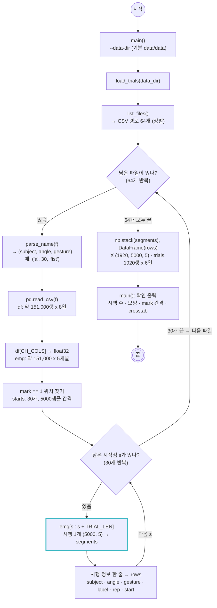

# scripts/data.py — CSV를 시행 단위로 읽기

실행: `python scripts/data.py` → 시행 수 · 배열 모양 · mark 간격 · 피험자x클래스 표 출력
다른 스크립트에서: `from data import load_trials`

CSV 64개(피험자 8명 x 각도 2종 x 동작 4종)를 읽어, 파일마다 `mark=1` 지점에서 5초(5000샘플)씩 30번 잘라 시행 1920개를 만든다.

## 데이터 예시

원본 CSV 한 파일 (`a_30 extor.csv`, 151361행). 1 ms마다 한 행, `mark=1`이 시행 시작. 첫 시행이 70행에서 시작한다.

|  | bandpass 1 | bandpass 2 | bandpass 3 | bandpass 4 | bandpass 5 | time | onset | mark |
|---|---|---|---|---|---|---|---|---|
| 0 | -0.0012 | -0.0016 | 0.0001 | 0.0032 | 0.0022 | 4.2480 | 0 | 0 |
| 1 | -0.0019 | -0.0023 | 0.0001 | 0.0028 | 0.0020 | 4.2490 | 0 | 0 |
| 70 | -0.0055 | -0.0000 | 0.0015 | 0.0037 | 0.0012 | 4.3180 | 1 | 1 |
| 71 | -0.0052 | -0.0004 | 0.0011 | 0.0026 | 0.0002 | 4.3190 | 0 | 0 |
| 5070 | -0.0092 | 0.0134 | 0.0015 | 0.0005 | -0.0026 | 9.3180 | 0 | 1 |

`load_trials()`가 돌려주는 `trials` 표 (1920행). i번째 행이 `X[i]`(5000 x 5 신호)의 설명이다. `start`는 그 시행이 CSV의 몇 번째 행에서 시작하는지.

|  | subject | angle | gesture | label | rep | start |
|---|---|---|---|---|---|---|
| 0 | a | 30 | supination | 30_supination | 1 | 70 |
| 1 | a | 30 | supination | 30_supination | 2 | 5070 |
| 29 | a | 30 | supination | 30_supination | 30 | 145070 |
| 30 | a | 30 | fist | 30_fist | 1 | 0 |
| 31 | a | 30 | fist | 30_fist | 2 | 5000 |
| 1919 | h | 60 | pronation | 60_pronation | 30 | 145000 |

`X.shape` = (1920, 5000, 5) (시행, 샘플 5초 x 1 kHz, 채널). `X[0][:3]`:

| bandpass 1 | bandpass 2 | bandpass 3 | bandpass 4 | bandpass 5 |
|---|---|---|---|---|
| -0.0055 | -0.0000 | 0.0015 | 0.0037 | 0.0012 |
| -0.0052 | -0.0004 | 0.0011 | 0.0026 | 0.0002 |
| -0.0052 | -0.0008 | 0.0008 | 0.0016 | -0.0012 |

## 메모

- `X[i]`와 `trials`의 `i`번째 행이 짝이다. 한쪽만 정렬하거나 섞으면 어긋난다.
- 첫 `mark` 앞의 대기 구간과 30번째 시행 뒤의 남은 기록은 어떤 조각에도 들어가지 않아 자동으로 빠진다.
- `mark` 간격이 4999~5001로 1샘플(1 ms)씩 흔들리는 파일이 있지만, 자르는 길이는 항상 5000으로 고정했다 (시행 길이가 같아야 배열로 쌓인다).
- `extor`는 회외(supination)로 바꿔 라벨에 쓴다. 라벨 = `각도_동작` (8클래스).
