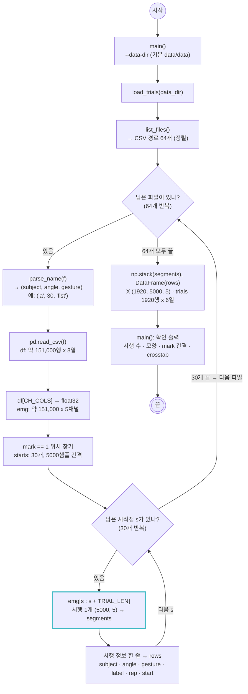

# scripts/data.py — CSV를 시행 단위로 읽기

실행: `python scripts/data.py` → 시행 수 · 배열 모양 · mark 간격 · 피험자x클래스 표 출력
다른 스크립트에서: `from data import load_trials`

CSV 64개(피험자 8명 x 각도 2종 x 동작 4종)를 읽어, 파일마다 `mark=1` 지점에서 5초(5000샘플)씩 30번 잘라 시행 1920개를 만든다.

## 메모

- `X[i]`와 `trials`의 `i`번째 행이 짝이다. 한쪽만 정렬하거나 섞으면 어긋난다.
- 첫 `mark` 앞의 대기 구간과 30번째 시행 뒤의 남은 기록은 어떤 조각에도 들어가지 않아 자동으로 빠진다.
- `mark` 간격이 4999~5001로 1샘플(1 ms)씩 흔들리는 파일이 있지만, 자르는 길이는 항상 5000으로 고정했다 (시행 길이가 같아야 배열로 쌓인다).
- `extor`는 회외(supination)로 바꿔 라벨에 쓴다. 라벨 = `각도_동작` (8클래스).
