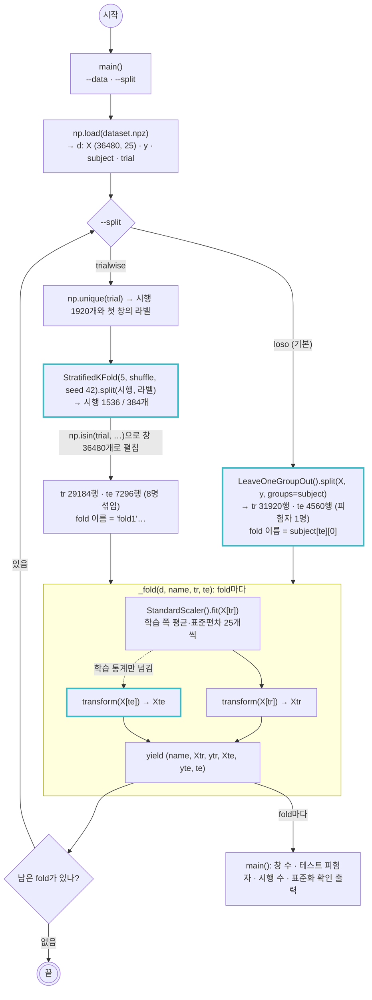

# scripts/loso.py — 분할 생성기 (LOSO · trial-wise) + fold 안 표준화

실행: `python scripts/loso.py [--data outputs/dataset.npz] [--split loso|trialwise]` → fold별 학습/테스트 모양 확인
다른 스크립트에서: `from loso import FOLDS` → `FOLDS["loso"](d)` 또는 `FOLDS["trialwise"](d)` (`scripts/2_training.py`가 `--split`으로 고른다)

`dataset.npz`(표준화 전 특징 36480행)를 받아 두 방식 중 하나로 나눈다. 어느 쪽이든 fold마다 학습 쪽 평균·표준편차로만 표준화하고, `(fold 이름, Xtr, ytr, Xte, yte, te)` 여섯 개를 낸다. `te`는 테스트 창의 행 번호라서 `d["subject"][te]`처럼 원본 열을 되찾는 데 쓴다.

| | `loso_folds` | `trialwise_folds` |
|---|---|---|
| 나누는 단위 | 피험자 (`subject` 열) | 시행 (`trial` 열), 라벨로 층화 |
| fold 수 · 이름 | 8 · `'a'`~`'h'` (테스트 피험자) | 5 · `'fold1'`~`'fold5'` |
| 테스트셋에 있는 것 | 학습 때 본 적 없는 사람 1명 | 8명 전원의 다른 시행 |
| 측정하는 것 | 처음 보는 사람에 대한 성능 | 같은 사람이 다시 했을 때의 성능 (논문·강의 방식) |

## 그림에서 봐야 할 것

- **두 생성기는 행 번호 `tr`/`te`만 다르게 고르고, 나머지는 `_fold()` 하나를 같이 쓴다.** 표준화 방식과 출력 형식이 같아서 `2_training.py`는 어느 쪽이든 같은 반복문으로 돈다.
- **LOSO의 분할 기준은 `subject` 열이다.** `groups=subject`를 넘기면 같은 피험자의 4560행이 통째로 한쪽에만 들어간다. 8명이라 fold도 8개다.
- **trial-wise는 시행을 먼저 나누고 창으로 펼친다.** 창 36480개를 바로 섞으면 50% 겹친 이웃 창이 양쪽에 들어가 정확도가 99%로 부푼다(2주차 누수 문제). 시행 1920개를 `StratifiedKFold`로 나눈 뒤 `np.isin`으로 그 시행에 속한 창을 고르면 한 시행의 창 19개가 같은 쪽으로 간다. 층화는 시행의 라벨(첫 창의 `y`)로 한다.
- **표준화는 비대칭이다.** `fit`은 `X[tr]`에서만, 테스트에는 `transform`만. 점선이 "학습 통계만 넘어간다"는 뜻이다. 테스트 값이 평균·표준편차에 섞이면 테스트를 미리 본 셈이 된다.
- **파일은 안 나누고 함수가 나눈다.** `dataset.npz`에는 분할도 표준화도 없다. 생성기가 호출될 때마다 행을 골라 그 자리에서 표준화한다.

## 한 fold의 모양

| | LOSO | trial-wise |
|---|---|---|
| `Xtr`, `ytr` | 31920행 = 7명 x 4560창 | 29184행 = 시행 1536개 x 19창 |
| `Xte`, `yte` | 4560행 = 1명 (8클래스 x 30회 x 19창) | 7296행 = 시행 384개 x 19창, 8명 섞임 |
| `te` | 그 피험자의 행 번호 4560개 | 그 시행들의 행 번호 7296개 |

## 메모

- 하이퍼파라미터 튜닝은 fold 안의 학습 쪽으로만 한다. 테스트 fold를 튜닝에 쓰면 교차검증을 하는 의미가 없다.
- `python scripts/loso.py` 출력의 "테스트 평균 최대"는 테스트셋의 특징 평균이 학습 기준에서 몇 표준편차 떨어져 있는지다. **LOSO는 0.57~1.71, trial-wise는 0.02~0.07.** 같은 사람이 학습에 있으면 테스트 분포가 학습과 거의 겹치고, 없으면 크게 어긋난다. 논문의 trial-wise 96%와 LOSO 성능이 다르게 나올 이유가 여기서 이미 보인다. LOSO에서 c, f가 1.5 이상으로 유독 크다.
- 논문(2.4절·4절)은 "분할을 시행 수준에서 했으므로 같은 참가자가 학습과 테스트 양쪽에 들어갈 수 있다. 보고된 성능은 처음 보는 사람에 대한 일반화가 아니며 후속 연구는 LOSO를 써야 한다"고 적었다. 이 프로젝트의 주 평가는 LOSO, `trialwise`는 논문 재현·대조용이다.
