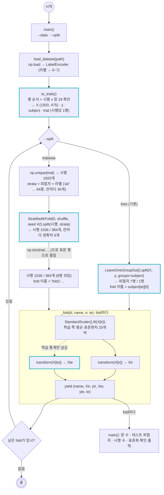

# scripts/loso.py — 표본 단위 · 분할 생성기 (LOSO · trial-wise) · fold 안 표준화

실행: `python scripts/loso.py [--data outputs/dataset.npz] [--split loso|trialwise]` → fold별 학습/테스트 모양 확인
다른 스크립트에서: `from loso import load_dataset, FOLDS` → `d, le = load_dataset(path)` 뒤 `FOLDS[split](d)` (`2_training.py`, `3_rf_validation.py`가 이렇게 쓴다)

세 가지 일을 한다.

1. **`load_dataset(path)`** — `dataset.npz`를 읽어 라벨을 0~7 정수로 바꾸고, `to_trials()`로 한 시행의 창 19개(각 25차원)를 순서대로 이어 붙여 **(1920, 475)** 시행 표본으로 만든다 (논문 Table 1의 1920개 구성).
2. **분할 생성기** — `loso_folds`(피험자 1명씩 테스트, 8-fold)와 `trialwise_folds`(시행을 피험자 x 라벨로 층화, 5-fold). 어느 쪽이든 한 시행의 창은 같은 쪽으로 간다.
3. **fold 안 표준화** — 매 fold 학습 쪽 평균·표준편차로만 `fit`하고 테스트에는 `transform`만.

생성기는 `(fold 이름, Xtr, ytr, Xte, yte, te)` 여섯 개를 낸다. `te`는 테스트 표본의 행 번호라서 `d["subject"][te]`처럼 원본 열을 되찾는 데 쓴다.

| | `loso_folds` | `trialwise_folds` |
|---|---|---|
| 나누는 단위 | 피험자 (`subject` 열) | 시행 (`trial` 열), 피험자 x 라벨로 층화 |
| fold 수 · 이름 | 8 · `'a'`~`'h'` (테스트 피험자) | 5 · `'fold1'`~`'fold5'` |
| 테스트셋에 있는 것 | 학습 때 본 적 없는 사람 1명 | 8명 전원의 다른 시행 |
| 측정하는 것 | 처음 보는 사람에 대한 성능 | 같은 사람이 다시 했을 때의 성능 (논문·강의 방식) |

## 그림에서 봐야 할 것

- **시행 단위 묶기는 분할 전에, 데이터 전체에 한 번 적용한다.** `to_trials()`는 시행 하나 안의 창 19개를 묶는 것뿐이라 다른 시행·다른 파일의 정보가 섞이지 않는다. 그래서 분할 전에 해도 누수가 아니다. 반대로 여러 시행을 묶어 계산하는 표준화는 반드시 분할 뒤 학습 쪽에서만 한다.
- **두 생성기는 행 번호 `tr`/`te`만 다르게 고르고, 나머지는 `_fold()` 하나를 같이 쓴다.** 표준화 방식과 출력 형식이 같아서 `2_training.py`는 어느 쪽이든 같은 반복문으로 돈다.
- **LOSO의 분할 기준은 `subject` 열이다.** `groups=subject`를 넘기면 같은 피험자의 4560행이 통째로 한쪽에만 들어간다. 8명이라 fold도 8개다.
- **trial-wise는 피험자 x 라벨 64칸을 기준으로 층화한다.** 라벨로만 층화하면 클래스 비율은 맞지만 fold마다 피험자별 시행 수가 36~60개로 흔들리고, 어떤 피험자 x 클래스 칸은 테스트에 0개가 된다. 칸마다 시행이 30개라 피험자 x 라벨로 층화하면 fold마다 정확히 6개씩 들어가 피험자 비율과 클래스 비율이 모두 같다. 논문은 클래스로 층화했다고만 적었지만, 이 방식도 클래스 비율을 지키므로 논문 방식에서 벗어나지 않는다.
- **표준화는 비대칭이다.** `fit`은 `X[tr]`에서만, 테스트에는 `transform`만. 점선이 "학습 통계만 넘어간다"는 뜻이다. 테스트 값이 평균·표준편차에 섞이면 테스트를 미리 본 셈이 된다.
- **파일은 안 나누고 함수가 나눈다.** `dataset.npz`에는 분할도 표준화도 없다. 생성기가 호출될 때마다 행을 골라 그 자리에서 표준화한다.

## 한 fold의 모양

| | LOSO | trial-wise |
|---|---|---|
| 학습 / 테스트 표본 (475차원) | 1680 / 240 = 7명 / 1명 x 240시행 | 1536 / 384 (논문 Table 1과 같음) |
| `te` | 그 피험자의 행 번호 240개 | 그 시행들의 행 번호 384개 |

## 메모

- 하이퍼파라미터 튜닝은 fold 안의 학습 쪽으로만 한다. 테스트 fold를 튜닝에 쓰면 교차검증을 하는 의미가 없다.
- `python scripts/loso.py` 출력의 "테스트 평균 최대"는 테스트셋의 특징 평균이 학습 기준에서 몇 표준편차 떨어져 있는지다. **LOSO가 trial-wise보다 훨씬 크다.** 같은 사람이 학습에 있으면 테스트 분포가 학습과 거의 겹치고, 없으면 크게 어긋난다. 논문의 trial-wise 96%와 LOSO 성능이 다르게 나올 이유가 여기서 이미 보인다. LOSO에서 c, f가 1.5 이상으로 유독 크다.
- 논문(2.4절·4절)은 "분할을 시행 수준에서 했으므로 같은 참가자가 학습과 테스트 양쪽에 들어갈 수 있다. 보고된 성능은 처음 보는 사람에 대한 일반화가 아니며 후속 연구는 LOSO를 써야 한다"고 적었다. 이 프로젝트의 주 평가는 LOSO, `trialwise`는 논문 재현·대조용이다.
