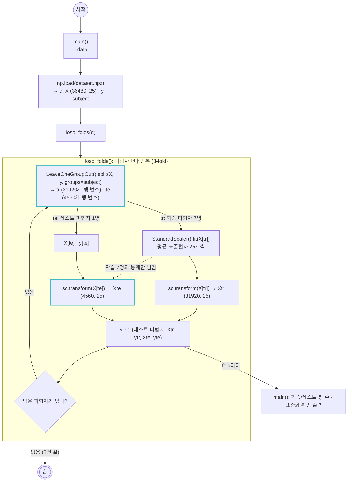

# scripts/loso.py — LOSO 분할 + fold 안 표준화

실행: `python scripts/loso.py [--data outputs/dataset.npz]` → fold별 학습/테스트 모양 확인
다른 스크립트에서: `from loso import loso_folds` (`scripts/training.py`가 이렇게 쓴다)

`dataset.npz`(표준화 전 특징 36480행)를 받아 피험자 한 명을 테스트로, 나머지 7명을 학습으로 나눈다. 테스트 피험자를 a~h로 바꾸며 8번 반복하고, 매번 학습 7명의 평균·표준편차로만 표준화한다.

## 그림에서 봐야 할 것

- **분할 기준은 `subject` 열이다.** `groups=subject`를 넘기면 같은 피험자의 4560행이 통째로 학습 또는 테스트 한쪽에만 들어간다. 8명이라 fold도 8개다.
- **표준화는 비대칭이다.** `fit`은 `X[tr]`(학습 7명)에서만, 테스트 피험자에는 `transform`만. 점선이 "학습 통계만 넘어간다"는 뜻이다. 테스트 피험자의 값이 평균·표준편차에 섞이면 그 사람을 미리 본 셈이 된다.
- **파일은 안 나누고 함수가 나눈다.** `dataset.npz`에는 분할도 표준화도 없다. `loso_folds()`가 호출될 때마다 `subject`로 행을 골라 그 자리에서 표준화한다. 그래서 `training.py`는 `for s, Xtr, ytr, Xte, yte in loso_folds(d):` 한 줄로 8-fold를 돈다.

## 한 fold의 모양

| | 행 수 | 내용 |
|---|---|---|
| `Xtr`, `ytr` | 31920 | 학습 피험자 7명 x 4560창. 7명 통계로 표준화됨 |
| `Xte`, `yte` | 4560 | 테스트 피험자 1명 (8클래스 x 30회 x 19창). 같은 통계로 표준화됨 |

## 메모

- 하이퍼파라미터 튜닝은 fold 안의 학습 7명으로만 한다. 테스트 피험자를 튜닝에 쓰면 LOSO를 하는 의미가 없다.
- `python scripts/loso.py` 출력의 "테스트 평균 최대"는 테스트 피험자의 특징 평균이 학습 7명 기준에서 얼마나 떨어져 있는지다. c, f가 1.5 이상으로 다른 피험자(0.6~0.8)보다 크다. 피험자 간 차이가 크다는 뜻이고, trial-wise보다 LOSO 정확도가 낮게 나올 이유다.
