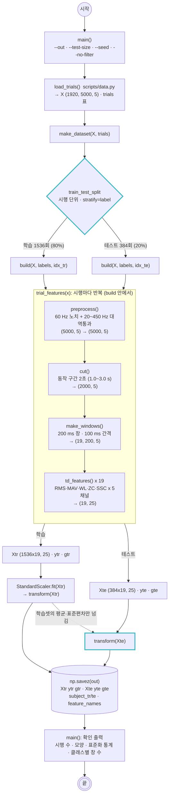

# scripts/preprocessing.py — 전처리 · 특징 추출 · 데이터셋 저장

실행: `python scripts/preprocessing.py [--out outputs/dataset.npz] [--test-size 0.2] [--seed 42] [--no-filter]`

시행 1920개를 **시행 단위로 먼저 학습/테스트로 나눈 뒤**, 각 집합 안에서만 필터 → 2초 자르기 → 200 ms 윈도우 → 25차원 특징을 만들고, 학습셋 통계로만 표준화해서 `dataset.npz`로 저장한다.

## 그림에서 봐야 할 것

- **분할이 특징 추출보다 먼저다.** 같은 시행에서 나온 19개 창은 서로 겹치기 때문에, 창을 만든 뒤에 나누면 한 시행의 조각이 학습과 테스트 양쪽에 들어간다(데이터 누수). 그래서 `train_test_split`이 `build()` 앞에 있다.
- **표준화는 비대칭이다.** 학습셋은 `fit` + `transform`, 테스트셋은 `transform`만. 점선 화살표가 "학습셋 통계만 넘어간다"는 뜻이다.
- **파이프라인은 한 번만 짜고 두 집합에 똑같이 적용한다.** `trial_features()` 안의 네 함수는 학습/테스트를 구분하지 않는다.
- `gtr/gte`(창이 온 시행 번호)와 `subject_tr/te`를 같이 저장하는 이유: 3주차 교차검증에서 같은 시행·피험자가 fold 사이로 갈라지지 않게 묶기 위해.

## 설정 메모 (강의 예시와 다른 점)

| 항목 | 강의 예시 | 이 스크립트 |
|---|---|---|
| 분할 단위 | 파일 = 시행 1개라서 `files`를 나눔 | 파일 하나에 30회가 있으므로 `trials` 행 번호(시행)를 나눔 |
| `cut()` 시작점 | `START=1500` (1.5 s, 실습 가정) | 1주차 4-2에서 확인한 실제 동작 구간 1.0~2.7 s에 맞춰 `START=1000` |
| 필터 | 원신호에 적용 | CSV 열 이름이 `bandpass 1~5`로, 이미 같은 필터가 걸려 있음. 강의 순서대로 한 번 더 걸되(차이 미미) `--no-filter`로 끌 수 있음 |
| ZC 임계값 | `th=0.01` | 같은 값. 단, 이 데이터는 진폭이 작아 Biceps·Triceps의 ZC가 0인 창이 30~50% → 3주차에서 낮춘 값과 비교해 볼 것 |
