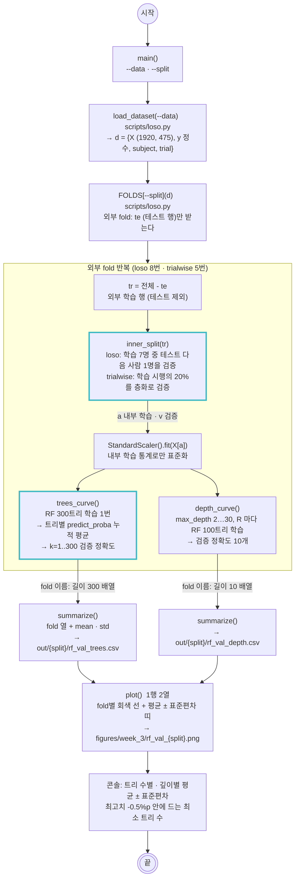

# scripts/3_rf_validation.py — RF 검증 히스토리 (트리 수 · 깊이)

실행: `python scripts/3_rf_validation.py [--data outputs/dataset.npz] [--split loso|trialwise]`

딥러닝의 epoch별 검증 곡선에 해당하는 것을 RF로 만든다. RF의 "학습 과정"은 트리를 하나씩 더하는 것이므로, 트리 N_MAX(300)개를 한 번 학습해 두고 **앞 k개만 다수결했을 때의 검증 정확도**를 k = 1…300으로 그린다. 여기에 `max_depth`를 바꿔 가며 학습한 **깊이 곡선**을 더해 `2_training.py`의 `RF_TREES`·`RF_MAX_DEPTH`를 정하는 근거로 쓴다. 검증 데이터는 외부 fold의 **학습 쪽 안에서** 떼므로 테스트 fold는 건드리지 않는다. 표본은 `2_training.py`와 같은 시행 단위(475차원)다.

## 그림에서 봐야 할 것

- **검증은 학습 쪽 안에서 뗀다.** 외부 fold의 테스트 행 `te`는 받자마자 제외하고, 나머지 `tr`에서 검증을 다시 뗀다. loso는 테스트 피험자 "다음" 사람을 검증으로 삼아 8 fold를 돌면 8명이 한 번씩 검증이 된다. 테스트 점수를 보고 하이퍼파라미터를 고르는 일이 구조적으로 불가능하다.
- **표준화도 내부 학습 쪽 통계만.** 검증 피험자(또는 검증 시행)의 값이 평균·표준편차에 섞이지 않는다.
- **트리 수 곡선은 학습 한 번으로 300점을 만든다.** RF 예측은 트리들의 확률 평균이므로, 트리별 `predict_proba`를 저장해 두고 누적 평균하면 "앞 k개만 쓴 RF"의 예측이 된다. 트리 수마다 다시 학습할 필요가 없다.
- **fold별 곡선을 평균 ± 표준편차로 모은다.** `2_training.py`가 fold 점수를 평균 ± 표준편차로 보고하는 것과 같은 방식이다. 그림의 회색 선이 fold 하나, 띠가 fold 간 변동이다.

## 결과 (2026-10-24)

| 분할 (검증) | 트리 1 → 20 → 100 → 300 | 최고치 -0.5%p 안 최소 트리 | 깊이 2 → 8 → 20 → R | 깊이 최적 |
|---|---|---|---|---|
| trialwise (학습 시행 20%) | 0.679 → 0.942 → 0.968 → 0.970 | 70개 | 0.500 → 0.939 → 0.969 → 0.968 | 20 (0.969) |
| loso (학습 7명 중 1명) | 0.329 → 0.438 → 0.459 → 0.466 | 222개 | 0.344 → 0.459 → 0.457 → 0.459 | 8~R 모두 0.46 |

fold 간 표준편차: trialwise 0.006~0.010, loso 0.10~0.14 (매우 큼).

## 결과 읽기

- **트리 100개, 깊이 제한 없음(논문 설정)은 두 분할 모두에서 타당하다.** trialwise는 트리 70개에서 포화하고 100개가 최고치 -0.3%p다. 깊이는 8 이상이면 차이가 0.5%p 안이다. 바꿀 이유가 없다.
- **loso 곡선은 띠가 곡선보다 넓다.** 트리 수나 깊이로 움직이는 폭(0.02~0.03)이 fold 간 편차(±0.11)의 4분의 1이다. 어떤 값을 골라도 "검증 피험자가 누구냐"에 묻힌다. 모델 설정으로 LOSO 성능을 끌어올릴 여지가 없다는 뜻이고, `docs/training.md`의 "각도 정보는 피험자 의존적"이라는 결론과 같다.
- **깊이 8이면 trialwise 0.94에 도달한다.** 475차원 시행 표본은 얕은 트리로도 가를 수 있는 구조를 갖는다. 깊이를 더 키워도 세션 서명(`docs/cut_sweep.md`)을 더 외울 뿐 LOSO는 움직이지 않는다.
- **이 곡선이 논문의 "hold-out 검증으로 튜닝"에 해당한다.** 논문은 RF를 기본값으로 뒀고 XGBoost만 예비 튜닝했다. 여기서는 RF 기본값이 왜 괜찮은지 곡선으로 확인한 셈이다. XGBoost의 라운드별 검증 곡선은 아직 없다.
