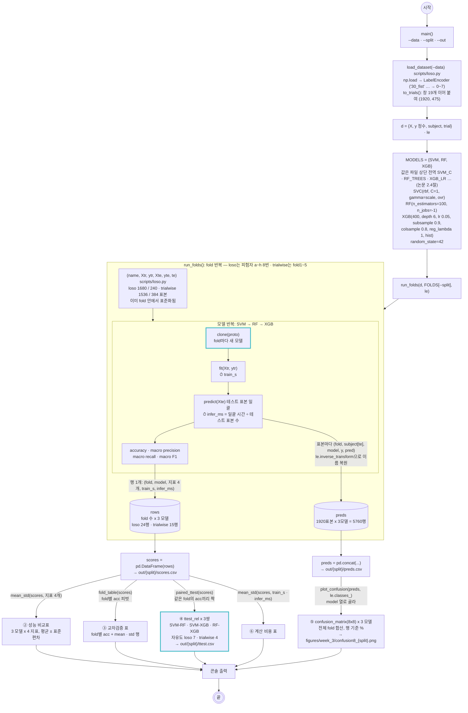

# scripts/2_training.py — 교차검증 학습 · 평가 · 검정

실행: `python scripts/2_training.py [--data outputs/dataset.npz] [--split loso|trialwise] [--out outputs/week_3]`

`dataset.npz`를 읽어 시행 단위 표본으로 묶고, `--split`이 고른 분할 생성기(`scripts/loso.py`의 `FOLDS`)로 fold를 돌리면서 SVM · RF · XGBoost 세 모델을 **같은 fold, 같은 표준화**로 학습·평가한다. fold가 끝나면 3주차 제출물 ②~⑥을 한 번에 만든다.

- **표본 = 시행 하나.** 창 19개의 25차원 특징을 순서대로 이어 붙여 475차원. 표본 1920개 = 논문 Table 1의 학습 1536 + 테스트 384. `load_dataset()`이 `dataset.npz`의 창 단위 배열을 묶는다.
- `--split loso` (기본): 피험자 1명을 통째로 테스트, 8-fold. 처음 보는 사람에 대한 성능.
- `--split trialwise`: 시행을 라벨로 층화해 5-fold. 논문·강의 방식. 같은 사람의 다른 시행에 대한 성능.

두 분할을 모두 돌려 `outputs/week_3/{split}/`에 저장한다. 논문의 hold-out 표는 fold 평균 ± 표준편차로 대신한다. 분할이 달라도 아래 흐름은 fold 이름·수와 표본 수만 바뀌고 나머지는 같다.

## 데이터 예시

`scores.csv` (loso, 24행 = fold 8 x 모델 3). rows 리스트의 행 하나가 이것:

| fold | model | acc | precision | recall | f1 | train_s | infer_ms |
|---|---|---|---|---|---|---|---|
| a | SVM | 0.6917 | 0.7331 | 0.6917 | 0.6803 | 0.1301 | 0.1602 |
| a | RF | 0.5292 | 0.6263 | 0.5292 | 0.5154 | 0.1763 | 0.05727 |
| a | XGB | 0.4958 | 0.5165 | 0.4958 | 0.4767 | 7.142 | 0.01263 |
| b | SVM | 0.525 | 0.5475 | 0.525 | 0.4784 | 0.1305 | 0.1665 |
| h | XGB | 0.5333 | 0.4825 | 0.5333 | 0.4659 | 7.164 | 0.01017 |

`preds.csv` (loso, 5760행 = 표본 1920 x 모델 3). 표본 하나가 한 행. 혼동행렬은 `model` 열로 골라 `y`와 `pred`를 센다:

| fold | subject | model | y | pred |
|---|---|---|---|---|
| a | a | SVM | 30_supination | 30_supination |
| a | a | SVM | 30_supination | 30_supination |
| a | a | SVM | 30_supination | 30_supination |
| a | a | RF | 30_supination | 30_supination |
| a | a | RF | 30_supination | 60_supination |
| h | h | XGB | 60_pronation | 30_fist |

`ttest.csv` (loso):

| pair | mean_diff | t | p | verdict |
|---|---|---|---|---|
| SVM vs RF | 0.04688 | 1.235 | 0.2565 | 유의하지 않음 |
| SVM vs XGB | 0.05729 | 1.497 | 0.178 | 유의하지 않음 |
| RF vs XGB | 0.01042 | 0.5735 | 0.5842 | 유의하지 않음 |

## 그림에서 봐야 할 것

- **하이퍼파라미터는 파일 상단 전역 변수에 모여 있다.** `SVM_C`, `SVM_GAMMA`, `RF_TREES`, `RF_MAX_DEPTH`, `XGB_TREES`, `XGB_MAX_DEPTH`, `XGB_LR`, `XGB_SUBSAMPLE`, `XGB_COLSAMPLE`, `XGB_LAMBDA`. 값을 바꿔 돌릴 때는 `--out`으로 다른 폴더를 줘야 기준 결과(scores·preds·ttest)를 덮어쓰지 않는다. 실행 시작 때 설정값을 출력하므로 로그만 봐도 어떤 값이었는지 안다. 하이퍼파라미터 조정은 `docs/rf_validation.md`의 검증 곡선으로 판단했고, 바꿀 이유가 없어 논문 설정을 그대로 쓴다. 튜닝은 fold 안의 학습 쪽으로만 해야 하고, 테스트 fold 점수를 보고 값을 고르면 그 점수는 더 이상 공정한 평가가 아니다.
- **표본은 시행 하나다.** 창 하나(200 ms)에는 동작의 한 순간만 있지만, 시행 하나(창 19개 이어 붙임)에는 힘이 오르고 내리는 2초의 시간 구조 전체가 있다. 논문 Table 1의 데이터 수(1536 + 384 = 1920)가 시행 수라서 논문의 표본도 시행이다. `to_trials()`는 `dataset.npz`의 행 순서가 시행 x 창 19임을 확인한 뒤 reshape만 하므로 1단계는 손댈 게 없다.
- **세 모델이 같은 fold를 본다.** 모델 반복이 fold 반복 안에 있어서 SVM · RF · XGB가 동일한 `Xtr/Xte`와 동일한 표준화 통계를 받는다. 강의의 "조건이 하나라도 다르면 비교가 성립하지 않는다"를 구조로 보장한다.
- **`clone()`이 fold마다 새 모델을 만든다.** 원형(`MODELS`)은 fit하지 않고, 매 fold마다 복제해서 학습한다. 이전 fold의 학습 결과가 다음 fold로 넘어가지 않는다.
- **t-검정의 짝은 "같은 fold"다.** `paired_ttest()`가 `scores`를 fold x 모델로 피벗해 같은 fold의 정확도끼리 묶는다. loso는 8 fold 자유도 7, trialwise는 강의와 같은 5 fold 자유도 4. 어느 쪽이든 작은 표본이라 p값 하나로 단정하지 않는다.
- **혼동행렬은 fold별로 안 그리고 전체 fold 예측을 합쳐 한 장.** loso에서 피험자 한 명만 그리면 그 사람 특성에 치우친다. 전체를 합치면 "처음 보는 사람" 기준의 오류 지도가 된다. 두 방식 모두 fold 크기가 같아서 합산 행렬은 fold별 행렬의 평균에 fold 수를 곱한 것과 같다. 그림은 행 기준 비율(%)로 정규화해 세 모델을 1행 3열로 그린다.
- **rows와 preds는 둘 다 표인데 알갱이 크기가 다르다.** rows는 fold가 끝날 때 정확도 같은 요약 숫자 한 행(loso 24행). preds는 표본 하나하나가 한 행으로, 열은 `fold · subject · model · y · pred` 다섯 개(5760행). trialwise에서는 테스트 fold에 8명이 섞여 있어서 `subject`를 fold 이름에서 알 수 없고, 생성기가 넘겨 주는 행 번호 `te`로 `d["subject"][te]`를 꺼내 채운다. 혼동행렬은 "어떤 클래스가 어떤 클래스로 틀렸나"를 표본 단위로 세어야 해서 요약 숫자로는 못 만들고 preds가 필요하다. `preds.csv`를 저장해 두므로 재학습 없이 피험자 한 명만 보거나 동작·각도별로 다시 집계할 수 있다.
- **LabelEncoder는 `load_dataset()`에서 한 번, 전체 `y`로 fit한다.** 라벨 이름 8종을 정수로 바꾸는 것뿐이라 테스트 피험자의 정보가 새지 않는다 (특징값을 쓰는 StandardScaler와 다르다). 분할 생성기는 `X · y · subject · trial` 키를 가진 dict를 받으므로 fold 안에서 따로 변환할 일이 없다. XGBoost만 정수가 필요하지만 "같은 조건" 원칙대로 세 모델 모두 정수 라벨로 학습한다. preds에 넣을 때 `le.inverse_transform`으로 이름을 되돌려 혼동행렬 축에 `30_fist` 같은 이름이 붙게 한다.
- **추론 시간은 일괄 예측 시간 ÷ 표본 수로 잰다.** 강의의 "1표본 x 100회" 방식은 `n_jobs=-1`인 RF가 predict 호출마다 스레드를 띄우는 고정 비용 때문에 RF가 SVM보다 10배 느리게 나온다. 창당 값으로 적는 이유는 (1) fold 크기가 달라 총 시간은 비교가 안 되고, (2) 논문 Table 5가 ms/sample이며, (3) 실시간 사용 시 "표본 하나에 몇 ms"가 배포 가능 여부를 가르기 때문이다. 단, 일괄 ÷ 표본 수는 처리량 기준이라 표본 하나를 넣었을 때의 지연(latency)보다 작게 나온다. 리포트에는 측정 방식과 이 차이를 명시한다.

## 만들어지는 파일

`{split}`은 `loso` 또는 `trialwise`. 두 번 실행하면 폴더 두 개가 생긴다.

| 파일 | 내용 | 제출물 |
|---|---|---|
| `outputs/week_3/{split}/scores.csv` | fold x 모델별 지표 4개 + train_s + infer_ms (loso 24행, trialwise 15행) | ②③⑥의 원본 |
| `outputs/week_3/{split}/preds.csv` | 표본마다 fold · subject · model · y · pred (5760행) | ⑤의 원본, 재학습 없이 다시 분석 |
| `outputs/week_3/{split}/ttest.csv` | 3행: 모델 쌍, 평균 차, t, p, 판정 | ④ |
| `figures/week_3/confusion8_{split}.png` | 세 모델 8x8 혼동행렬 1행 3열, 행 기준 % | ⑤ (리포트에는 RF 대표) |

## 결과 (2026-10-24 실행, Mac mini)

### ② 성능 비교표 (fold 평균 ± 표준편차, macro)

| 분할 | 모델 | acc | precision | recall | F1 |
|---|---|---|---|---|---|
| trialwise 5-fold | SVM | **0.976 ± 0.007** | 0.976 | 0.976 | 0.976 |
| | RF | **0.968 ± 0.008** | 0.969 | 0.968 | 0.968 |
| | XGB | **0.967 ± 0.004** | 0.968 | 0.967 | 0.967 |
| loso 8-fold | SVM | 0.519 ± 0.125 | 0.541 | 0.519 | 0.486 |
| | RF | 0.472 ± 0.105 | 0.488 | 0.472 | 0.423 |
| | XGB | 0.462 ± 0.115 | 0.469 | 0.462 | 0.416 |

논문 Table 3 (trial-wise 5-fold): RF 96.72 ± 0.58, XGBoost 96.15 ± 0.56, SVM 95.83 ± 0.79. RF 96.82 ± 0.77, XGB 96.72 ± 0.39가 그대로 재현되고 SVM만 97.55로 논문보다 조금 높다. trial-wise fold는 피험자 x 라벨 64칸에서 6개씩 뽑아 피험자·클래스 비율이 fold 간에 같다.

### ③ fold별 정확도

| loso | SVM | RF | XGB | | trialwise | SVM | RF | XGB |
|---|---|---|---|---|---|---|---|---|
| a | 0.692 | 0.529 | 0.496 | | fold1 | 0.969 | 0.974 | 0.971 |
| b | 0.525 | 0.529 | 0.458 | | fold2 | 0.982 | 0.974 | 0.969 |
| c | 0.554 | 0.546 | 0.621 | | fold3 | 0.971 | 0.971 | 0.969 |
| d | 0.471 | 0.304 | 0.271 | | fold4 | 0.971 | 0.956 | 0.961 |
| e | 0.671 | 0.550 | 0.558 | | fold5 | 0.984 | 0.966 | 0.966 |
| f | 0.300 | 0.392 | 0.350 | | | | | |
| g | 0.463 | 0.354 | 0.408 | | | | | |
| h | 0.479 | 0.575 | 0.533 | | | | | |

### ④ 대응표본 t-검정 (fold별 정확도)

| 분할 | 쌍 | 평균 차 | t | p | 판정 |
|---|---|---|---|---|---|
| trialwise (자유도 4) | SVM vs RF | +0.007 | 1.63 | 0.178 | 유의하지 않음 |
| | SVM vs XGB | +0.008 | 2.24 | 0.089 | 유의하지 않음 |
| | RF vs XGB | +0.001 | 0.59 | 0.587 | 유의하지 않음 |
| loso (자유도 7) | SVM vs RF | +0.047 | 1.24 | 0.257 | 유의하지 않음 |
| | SVM vs XGB | +0.057 | 1.50 | 0.178 | 유의하지 않음 |
| | RF vs XGB | +0.010 | 0.57 | 0.584 | 유의하지 않음 |

### ⑥ 계산 비용 (fold 평균, loso 학습셋 1680 x 475)

| 모델 | 학습 | 추론 ms/표본 |
|---|---|---|
| SVM | 0.13 s | 0.169 |
| RF | 0.15 s | 0.054 |
| XGB | 7.1 s | 0.008 |

논문 Table 5: 학습 RF 0.31 s, SVM 0.33 s, XGBoost 19.8 s · 추론 RF 0.036, SVM 0.382, XGBoost 0.031 ms. 순서(XGB가 학습 최장, SVM이 추론 최장)와 크기가 논문과 맞는다.

### 보조 집계 (preds.csv에서, 8클래스를 동작 4종 · 각도 2종으로 묶어 다시 채점)

| 분할 | 모델 | 8클래스 | 동작 4종만 | 각도 2종만 |
|---|---|---|---|---|
| trialwise | RF | 0.968 | 0.99 | 0.97 |
| loso | SVM | 0.519 | 0.745 | 0.649 |
| loso | RF | 0.472 | 0.751 | 0.595 |
| 우연 수준 | | 0.125 | 0.25 | 0.5 |

## 결과 읽기

- **논문 방식(trial-wise)은 그대로 재현된다.** RF 96.8%로 Table 3의 96.72%와 같고, 학습·추론 시간(Table 5)도 같은 그림이다. 전처리·특징·모델 설정이 논문과 맞는다는 확인이다.
- **처음 보는 사람에게는 동작은 되고 각도는 안 된다.** LOSO에서 동작 4종은 0.75(우연 0.25), 각도 2종은 0.60~0.65(우연 0.5)다. 혼동행렬(`confusion8_loso.png`)의 큰 칸이 전부 같은 동작의 다른 각도(30_open → 60_open 44%, 30_fist → 60_fist 24%)다. 논문 3.5절이 trial-wise에서 본 "각도 간 혼동이 주 오류"가 LOSO에서는 지배적 오류가 된다. 각도 정보는 사람마다 다른 방식으로 나타나서 다른 사람의 패턴으로는 못 맞힌다.
- **LOSO는 fold 편차가 크다.** 표준편차 0.10~0.12로, 피험자 a·e는 0.67~0.69인데 f는 0.30이다. 8명 평균 하나로 "LOSO 50%"라고 말하면 절반만 말한 것이다. 세 모델 차이도 이 편차 안에 묻혀 어느 쌍도 유의하지 않다.
- **trial-wise에서 세 모델 차이는 유의하지 않다. 논문의 결론과 같다.** 순위는 SVM > RF > XGB로 논문(RF > XGB > SVM)과 다르지만 차이가 0.1~0.8%p이고 세 쌍 모두 p > 0.08이다. 논문도 "RF가 1위였지만 세 모델 간 차이는 유의하지 않았다"였다. 참고로 라벨로만 층화한 분할에서는 SVM이 유의하게 높게 나왔었는데(p ≈ 0.03), 피험자 x 라벨로 층화해 fold를 공평하게 맞추니 사라졌다. fold 구성이 조금만 달라져도 뒤집히는 수준의 차이라는 뜻이고, 리포트에는 p값과 함께 평균 차를 적는다.
- **trial-wise 점수에는 파일(세션)별 잡음 서명이 섞여 있다** (`docs/cut_sweep.md`). 이 데이터는 피험자 x 클래스마다 CSV 파일 하나가 별도 세션이라 파일마다 휴식 잡음 수준이 다르다. 동작이 없는 3~5 s 구간만으로도 trial-wise RF가 78%를 내는 반면 LOSO는 우연으로 떨어진다. 즉 논문 방식 96.8% 중 약 78%는 "어느 파일에서 왔나"로 설명되고, 동작 정보가 그 위에 약 18%p를 얹는다. LOSO가 그 서명을 걷어낸 값이다.
- **계산 비용은 논문과 같은 그림이다.** 학습은 XGBoost(7 s)가 가장 느리고 SVM·RF는 0.15 s, 추론은 SVM이 가장 느리다. 모두 100 ms 창 간격보다 훨씬 작다.

## 남은 것

1. **리포트.** 서사는 "논문 방식(trial-wise)으로 96.7% 재현 → 같은 표본으로 LOSO 47~52%, 동작은 되고 각도는 안 됨 → cut 실험으로 trial-wise의 세션 서명 몫 분리". 한계 ⑦에는 trial-wise 분할 문제(논문 4절 인용 + cut 실험), 세션 서명과 데이터 수집 설계(클래스마다 파일 분리), LOSO fold 편차, 피험자 8명, 각도 정보의 피험자 의존성을 적는다.
