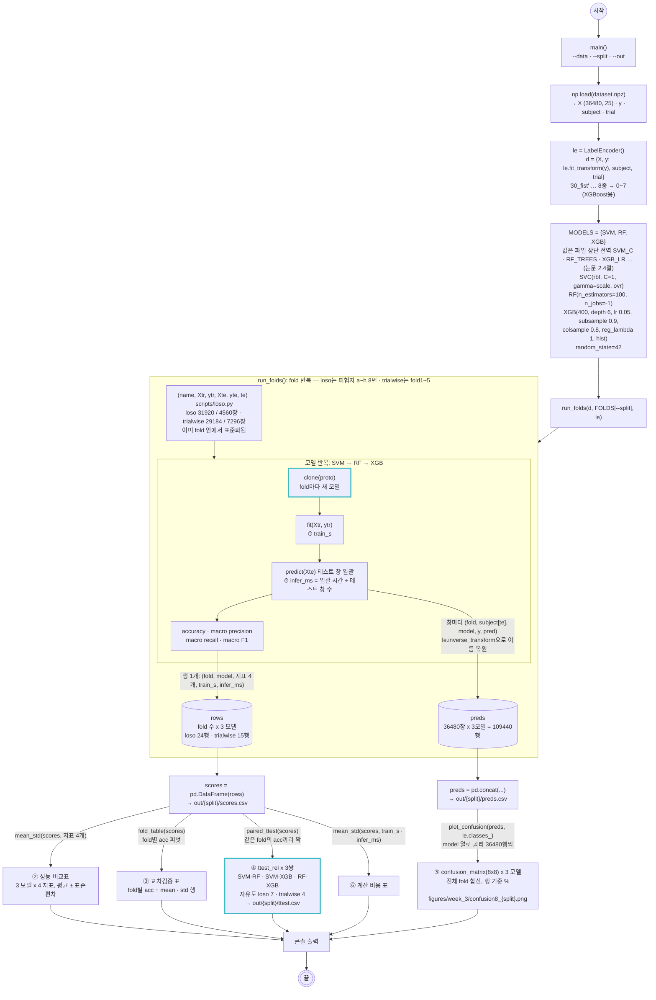

# scripts/2_training.py — 교차검증 학습 · 평가 · 검정

실행: `python scripts/2_training.py [--data outputs/dataset.npz] [--split loso|trialwise] [--out outputs/week_3]`

`dataset.npz`를 읽어 `--split`이 고른 분할 생성기(`scripts/loso.py`의 `FOLDS`)로 fold를 돌리면서 SVM · RF · XGBoost 세 모델을 **같은 fold, 같은 표준화**로 학습·평가한다. fold가 끝나면 3주차 제출물 ②~⑥을 한 번에 만든다. 주 평가는 `loso`(8-fold, 처음 보는 사람), `trialwise`(시행 단위 5-fold)는 논문·강의 방식 재현과 대조용이다. 논문의 hold-out 표는 fold별 지표의 평균 ± 표준편차로 대신한다. 분할 방식이 달라도 아래 흐름은 fold 이름과 fold 수만 바뀌고 나머지는 같다.

## 그림에서 봐야 할 것

- **하이퍼파라미터는 파일 상단 전역 변수에 모여 있다.** `SVM_C`, `SVM_GAMMA`, `RF_TREES`, `RF_MAX_DEPTH`, `XGB_TREES`, `XGB_MAX_DEPTH`, `XGB_LR`, `XGB_SUBSAMPLE`, `XGB_COLSAMPLE`, `XGB_LAMBDA`. 값을 바꿔 돌릴 때는 `--out`으로 다른 폴더를 줘야 기준 결과(scores·preds·ttest)를 덮어쓰지 않는다. 실행 시작 때 설정값을 출력하므로 로그만 봐도 어떤 값이었는지 안다. 하이퍼파라미터 조정은 `docs/rf_validation.md`의 검증 곡선으로 판단했고, 바꿀 이유가 없어 논문 설정을 그대로 쓴다. 튜닝은 fold 안의 학습 쪽으로만 해야 하고, 테스트 fold 점수를 보고 값을 고르면 그 점수는 더 이상 공정한 평가가 아니다.
- **세 모델이 같은 fold를 본다.** 모델 반복이 fold 반복 안에 있어서 SVM · RF · XGB가 동일한 `Xtr/Xte`와 동일한 표준화 통계를 받는다. 강의의 "조건이 하나라도 다르면 비교가 성립하지 않는다"를 구조로 보장한다.
- **`clone()`이 fold마다 새 모델을 만든다.** 원형(`MODELS`)은 fit하지 않고, 매 fold마다 복제해서 학습한다. 이전 fold의 학습 결과가 다음 fold로 넘어가지 않는다.
- **t-검정의 짝은 "같은 fold"다.** `paired_ttest()`가 `scores`를 fold x 모델로 피벗해 같은 fold의 정확도끼리 묶는다. loso는 8 fold 자유도 7, trialwise는 강의와 같은 5 fold 자유도 4. 어느 쪽이든 작은 표본이라 p값 하나로 단정하지 않는다.
- **혼동행렬은 fold별로 안 그리고 전체 fold 예측을 합쳐 한 장.** loso에서 피험자 한 명의 4560창만 그리면 그 사람 특성에 치우친다. 36480창 전체를 합치면 "처음 보는 사람" 기준의 오류 지도가 된다. 두 방식 모두 fold 크기가 같아서(loso 4560창, trialwise 7296창) 합산 행렬은 fold별 행렬의 평균에 fold 수를 곱한 것과 같다. 그림은 행 기준 비율(%)로 정규화해 세 모델을 1행 3열로 그린다.
- **rows와 preds는 둘 다 표인데 알갱이 크기가 다르다.** rows는 fold가 끝날 때 정확도 같은 요약 숫자 한 행(loso 24행). preds는 창 하나하나가 한 행으로, 열은 `fold · subject · model · y · pred` 다섯 개(109440행). trialwise에서는 테스트 fold에 8명이 섞여 있어서 `subject`를 fold 이름에서 알 수 없고, 생성기가 넘겨 주는 행 번호 `te`로 `d["subject"][te]`를 꺼내 채운다. 혼동행렬은 "어떤 클래스가 어떤 클래스로 틀렸나"를 창 단위로 세어야 해서 요약 숫자로는 못 만들고 preds가 필요하다. `preds.csv`를 저장해 두므로 재학습 없이 피험자 한 명만 보거나 동작·각도별로 다시 집계할 수 있다.
- **LabelEncoder는 fold 밖에서 한 번, 전체 `y`로 fit한다.** 라벨 이름 8종을 정수로 바꾸는 것뿐이라 테스트 피험자의 정보가 새지 않는다 (특징값을 쓰는 StandardScaler와 다르다). 분할 생성기는 `X · y · subject · trial` 키를 가진 dict를 받으므로 정수 라벨로 바꾼 dict를 넘기면 fold 안에서 따로 변환할 일이 없다. XGBoost만 정수가 필요하지만 "같은 조건" 원칙대로 세 모델 모두 정수 라벨로 학습한다. preds에 넣을 때 `le.inverse_transform`으로 이름을 되돌려 혼동행렬 축에 `30_fist` 같은 이름이 붙게 한다.
- **추론 시간은 일괄 예측 시간 ÷ 창 수로 잰다.** 강의의 "1창 x 100회" 방식을 시험해 보니 RF가 13.6 ms/창으로 SVM(1.1 ms)보다 10배 느리게 나왔다. `n_jobs=-1`인 RF가 predict 호출마다 스레드를 띄우는 비용이지 모델 자체의 추론 비용이 아니다. 창당 값으로 적는 이유는 (1) loso 4560창·trialwise 7296창으로 fold 크기가 달라 총 시간은 비교가 안 되고, (2) 강의·논문 표가 ms/sample이며, (3) 실시간 사용 시 200 ms 창이 100 ms마다 하나씩 들어오므로 "창 하나에 몇 ms"가 배포 가능 여부를 가르는 숫자이기 때문이다. 단, 일괄 ÷ 창 수는 처리량 기준이라 창 하나를 넣었을 때의 지연(latency)보다 작게 나온다. 리포트에는 측정 방식과 이 차이를 명시한다.

## 만들어지는 파일

`{split}`은 `loso` 또는 `trialwise`. 두 번 실행하면 폴더 두 개가 생긴다.

| 파일 | 내용 | 제출물 |
|---|---|---|
| `outputs/week_3/{split}/scores.csv` | fold x 모델별 지표 4개 + train_s + infer_ms (loso 24행, trialwise 15행) | ②③⑥의 원본 |
| `outputs/week_3/{split}/preds.csv` | 109440행: fold · subject · model · y · pred (창 단위) | ⑤의 원본, 재학습 없이 다시 분석 |
| `outputs/week_3/{split}/ttest.csv` | 3행: 모델 쌍, 평균 차, t, p, 판정 | ④ |
| `figures/week_3/confusion8_{split}.png` | 세 모델 8x8 혼동행렬 1행 3열, 행 기준 % | ⑤ (리포트에는 RF 대표) |

## 결과 (2026-10-24 실행, Mac mini)

### ② 성능 비교표 (fold 평균 ± 표준편차, macro)

| 분할 | 모델 | acc | precision | recall | F1 |
|---|---|---|---|---|---|
| loso (8-fold) | SVM | 0.253 ± 0.027 | 0.267 ± 0.044 | 0.253 ± 0.027 | 0.242 ± 0.029 |
| | RF | 0.253 ± 0.025 | 0.261 ± 0.033 | 0.253 ± 0.025 | 0.248 ± 0.026 |
| | XGB | 0.257 ± 0.029 | 0.268 ± 0.038 | 0.257 ± 0.029 | 0.249 ± 0.031 |
| trialwise (5-fold) | SVM | 0.484 ± 0.007 | 0.497 ± 0.006 | 0.484 ± 0.007 | 0.485 ± 0.007 |
| | RF | 0.605 ± 0.008 | 0.606 ± 0.008 | 0.605 ± 0.008 | 0.605 ± 0.008 |
| | XGB | 0.592 ± 0.009 | 0.593 ± 0.009 | 0.592 ± 0.009 | 0.592 ± 0.009 |

### ③ fold별 정확도

| loso | SVM | RF | XGB | | trialwise | SVM | RF | XGB |
|---|---|---|---|---|---|---|---|---|
| a | 0.261 | 0.265 | 0.250 | | fold1 | 0.475 | 0.606 | 0.586 |
| b | 0.247 | 0.234 | 0.224 | | fold2 | 0.482 | 0.610 | 0.596 |
| c | 0.213 | 0.237 | 0.252 | | fold3 | 0.491 | 0.608 | 0.583 |
| d | 0.261 | 0.265 | 0.280 | | fold4 | 0.479 | 0.592 | 0.590 |
| e | 0.277 | 0.248 | 0.266 | | fold5 | 0.491 | 0.610 | 0.605 |
| f | 0.297 | 0.298 | 0.302 | | | | | |
| g | 0.243 | 0.263 | 0.269 | | | | | |
| h | 0.223 | 0.217 | 0.214 | | | | | |

### ④ 대응표본 t-검정 (fold별 정확도)

| 분할 | 쌍 | 평균 차 | t | p | 판정 |
|---|---|---|---|---|---|
| loso (자유도 7) | SVM vs RF | -0.001 | -0.10 | 0.926 | 유의하지 않음 |
| | SVM vs XGB | -0.005 | -0.59 | 0.572 | 유의하지 않음 |
| | RF vs XGB | -0.004 | -0.91 | 0.393 | 유의하지 않음 |
| trialwise (자유도 4) | SVM vs RF | -0.122 | -35.2 | <0.001 | 유의함 |
| | SVM vs XGB | -0.108 | -25.8 | <0.001 | 유의함 |
| | RF vs XGB | +0.013 | 3.04 | 0.039 | 유의함 |

### ⑥ 계산 비용 (fold 평균)

| 모델 | 학습 (loso 31920창) | 추론 ms/창 |
|---|---|---|
| SVM | 19.9 s | 1.10 |
| RF | 1.1 s | 0.004 |
| XGB | 4.9 s | 0.004 |

loso 8 fold 약 3.5분, trialwise 5 fold 약 2분.

### 보조 집계 (preds.csv에서, 모델 RF)

| 분할 | 8클래스 | 동작 4종만 (각도 무시) | 각도 2종만 (동작 무시) |
|---|---|---|---|
| trialwise | 0.605 | 0.730 | 0.762 |
| loso | 0.253 | 0.472 | 0.514 |
| 우연 수준 | 0.125 | 0.25 | 0.5 |

## 결과 읽기

- **LOSO에서는 세 모델이 구별되지 않는다.** 정확도 0.25 안팎, 세 쌍 모두 p > 0.39. 각도 2종만 보면 0.51~0.53으로 우연 수준(0.5)과 같다. 처음 보는 사람의 팔꿈치 각도는 이 특징으로는 전혀 못 맞히고, 동작 4종도 0.47로 우연(0.25)의 두 배에 그친다. `docs/loso.md`의 피험자 간 분포 어긋남(0.57~1.71 표준편차)이 그대로 성능으로 나타났다.
- **trial-wise에서는 RF > XGB > SVM이 유의하다.** 논문과 순위는 같지만 논문은 세 쌍 모두 유의하지 않았고 여기서는 모두 유의하다. fold 간 표준편차가 0.007~0.009로 매우 작아 작은 차이도 유의하게 잡힌 것이고, 효과 크기는 RF-XGB 1.3%p로 작다. 리포트에는 p값과 함께 평균 차를 적는다.
- **논문의 96.7%는 재현되지 않았다. 분할도, 특징 설정도 원인이 아니다.** trial-wise RF 60.5%이고, 창 단위로 섞는 누수 분할로 돌려도 63.9%다. 특징 설정을 바꿔도 안 움직인다: ZC 임계값 0.01 → 0 또는 0.001 (60.7 · 60.9%), 필터 생략 (61.2%), 피험자별 사전 z-score (61.2%). 혼동행렬의 오류 구조(같은 동작의 다른 각도끼리 혼동, 14~15%p)는 논문 3.5절과 같다.
- **trial-wise 정확도의 상당 부분은 근육 신호가 아니라 파일(세션)별 잡음 서명이다** (재현: `scripts/4_cut_sweep.py`, `docs/cut_sweep.md`). cut 시작점을 바꿔 보면 동작 구간 1~3 s가 60.6%로 **가장 낮고**, 동작 전 휴식 0~2 s가 67.9%, 동작 후 휴식 3~5 s가 **78.6%로 가장 높다**. 아무것도 안 하는 구간이 동작 구간보다 잘 맞는다. 이 데이터는 피험자 x 클래스마다 CSV 파일 하나가 별도 세션으로 기록되어서, 파일마다 휴식 시 RMS 수준이 다르다 (피험자 a: ch3 휴식 RMS가 fist 15, open 3~8, supination 3~4 x10⁻³). 같은 파일의 rep 1~15로 학습해 rep 16~30을 맞혀도 휴식 특징이 67%라 이 서명은 파일 안에서 안정적이다. trial-wise에서는 "어느 파일에서 왔나"를 맞히는 지름길이 열려 있고, LOSO에서는 그 지름길이 닫혀 25%로 떨어진다. 시행 안 창 위치별 정확도도 가장 활발한 창(1.6~1.8 s)이 73%, 거의 휴식인 양 끝 창이 48~52%로, 휴식 창조차 우연(12.5%)의 4배다.
- **그래서 논문의 96.7%는 어떻게 나왔나. cut 위치만으로는 안 되고, 파일별 정규화가 겹쳐야 닿는다.** cut 위치 x (분할 · 파일별 z-score) 조합을 RF로 돌린 표 (trial-wise 5-fold 평균):

  | cut | 시행 단위 | 창 단위 섞기 | 파일 z + 시행 | 파일 z + 창 섞기 |
  |---|---|---|---|---|
  | 1~3 s (동작) | 60.6% | 64.0% | 78.8% | 80.7% |
  | 0~2 s (동작 전 휴식) | 67.9% | 71.9% | 85.6% | 86.9% |
  | 3~5 s (동작 후 휴식) | 78.6% | 84.9% | **99.1%** | 99.4% |
  | 0~5 s (전체) | 70.5% | 74.5% | 92.2% | 93.0% |

  cut만 바꾸면 최대 78.6%, 창 단위 섞기를 더해도 84.9%다. 96%를 넘기는 조합은 **파일(피험자 x 클래스 CSV)별 z-score**가 들어간 것뿐이다. 파일 하나가 클래스 하나라서 파일별로 정규화하면 라벨이 특징에 새겨진다. CSV를 하나씩 읽어 각각 StandardScaler를 거는 흔한 실수가 이에 해당한다. 논문 코드를 못 봤으니 단정은 못 하지만, 공개된 설명(2초 세그먼트, 시행 단위 분할)으로 재현되는 값은 60%대이고, 96%대는 파일 단위 처리 없이는 나오지 않는다. 리포트에는 이 표를 싣고 "재현 실패, 가장 유력한 원인은 파일 단위 정규화"로 쓴다.
- **계산 비용은 논문과 같은 그림이다.** 학습은 SVM이 가장 느리고(RF의 18배), 추론도 SVM이 1 ms/창으로 트리 모델의 250배다. 그래도 100 ms 창 간격 안에는 모두 들어온다.

## 남은 것

1. **96% 미재현은 더 추적하지 않는다.** cut 실험은 `4_cut_sweep.py`로 저장소에 넣었고(LOSO 포함), 리포트의 핵심 그림이다. 분할·ZC 임계값·필터·cut 시작점·피험자별 표준화를 모두 바꿔 봤고 (2026-10-24, 스크래치 실험), 어느 것도 96%에 가지 않았다. 대신 "휴식 구간이 동작 구간보다 잘 맞는다"는 결과를 리포트의 trial-wise 분할 문제 근거로 쓴다. 필요하면 `1_preprocessing.py`에 `--start` 플래그를 넣어 3~5 s 데이터셋을 만들고 `2_training.py --data`로 표를 재생산한다.
2. **리포트.** ②~⑥ 표는 위에서 그대로 가져가고, 한계 ⑦에는 trial-wise 분할 문제(논문 4절 인용 + 휴식 구간 78.6% 실험), 96% 미재현, 파일별 세션 서명, 피험자 8명·fold 간 작은 표본, 각도 정보 부족을 적는다.
