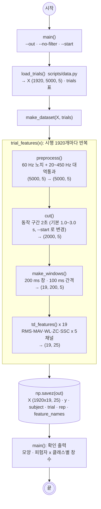

# scripts/1_preprocessing.py — 전처리 · 특징 추출 · 데이터셋 저장

실행: `python scripts/1_preprocessing.py [--out outputs/dataset.npz] [--no-filter] [--start 1.0]`

시행 1920개 전체에 필터 → 2초 자르기 → 200 ms 윈도우 → 25차원 특징을 만들어 `dataset.npz`로 저장한다. 학습/테스트 분할과 표준화는 하지 않는다 (`scripts/loso.py`가 fold마다 한다).

## 데이터 예시

시행 0 (`a`, `30_supination`, 1회차) 처리 과정의 모양: 필터 후 (5000, 5) → `cut()` (2000, 5) → `make_windows()` (19, 200, 5).

창 하나(9번째 창, 1.8~2.0 s)의 `td_features()` 결과 25개를 특징 x 채널로 펼친 것. 저장될 때는 RMS 5개 → MAV 5개 → … 순서의 한 줄(25열)이 된다.

| 특징 \ 채널 | bandpass 1 | bandpass 2 | bandpass 3 | bandpass 4 | bandpass 5 |
|---|---|---|---|---|---|
| RMS | 0.006316 | 0.01708 | 0.02239 | 0.04493 | 0.00611 |
| MAV | 0.004785 | 0.01368 | 0.01523 | 0.03272 | 0.004616 |
| WL | 0.5543 | 1.484 | 1.727 | 1.896 | 0.3138 |
| ZC | 3 | 17 | 18 | 10 | 1 |
| SSC | 59 | 54 | 41 | 21 | 41 |

`dataset.npz`를 표로 보면 (36480행 x 25열 + 라벨 열. 열 7개만 표시). 행 0~18이 시행 0의 창 19개, 행 19부터 시행 1.

| 행 | trial | subject | y | rep | RMS_bandpass 1 | RMS_bandpass 2 | MAV_bandpass 1 | WL_bandpass 1 | ZC_bandpass 1 | SSC_bandpass 1 | SSC_bandpass 5 |
|---|---|---|---|---|---|---|---|---|---|---|---|
| 0 | 0 | a | 30_supination | 1 | 0.01518 | 0.01457 | 0.01105 | 0.728 | 4 | 42 | 36 |
| 1 | 0 | a | 30_supination | 1 | 0.01724 | 0.0209 | 0.01358 | 0.9518 | 6 | 37 | 34 |
| 2 | 0 | a | 30_supination | 1 | 0.01188 | 0.02466 | 0.009187 | 0.7396 | 3 | 39 | 32 |
| 18 | 0 | a | 30_supination | 1 | 0.006053 | 0.01451 | 0.004244 | 0.3468 | 1 | 42 | 51 |
| 19 | 1 | a | 30_supination | 2 | 0.01142 | 0.0189 | 0.007871 | 0.6073 | 4 | 37 | 50 |
| 20 | 1 | a | 30_supination | 2 | 0.01712 | 0.01732 | 0.01367 | 1.029 | 7 | 31 | 40 |
| 36479 | 1919 | h | 60_pronation | 30 | 0.01656 | 0.01245 | 0.01166 | 0.7905 | 2 | 38 | 32 |

## 출력 `dataset.npz`

numpy 배열 6개를 묶은 zip. 행 하나 = 창 하나이고, 길이 36480(= 시행 1920 x 창 19)인 배열들은 i번째 행이 서로 짝이 맞는다.

| 키 | 모양 | 내용 |
|---|---|---|
| `X` | (36480, 25) | 표준화 전 특징 |
| `y` | (36480,) | 라벨 `'30_fist'` ... 8종 |
| `subject` | (36480,) | 피험자 `'a'`~`'h'`. 피험자마다 4560행 (8클래스 x 30회 x 19창). LOSO 분할 기준 |
| `trial` | (36480,) | 시행 번호 0~1919 |
| `rep` | (36480,) | 반복 회차 1~30 |
| `feature_names` | (25,) | `X`의 열 이름 |

행 순서: 피험자 a → 클래스 8개 → 회차 1~30 → 창 1~19, 그 다음 피험자 b.

## 왜 분할·표준화를 여기서 안 하나

필터·자르기·윈도우·특징은 시행 하나 안에서만 계산되므로 어떻게 나누든 결과가 같다 → 한 번만 만들어 저장한다. 표준화의 평균·표준편차는 학습셋에서만 구해야 하는데 LOSO에서는 학습셋이 fold마다 바뀐다 → 저장하지 않고 fold 안에서 한다.

## 설정 메모 (강의 예시와 다른 점)

| 항목 | 강의 예시 | 이 스크립트 |
|---|---|---|
| `cut()` 시작점 | `START=1500` (1.5 s, 실습 가정) | 1주차 4-2에서 확인한 실제 동작 구간 1.0~2.7 s에 맞춰 `START=1000` |
| 필터 | 원신호에 적용 | CSV 열 이름이 `bandpass 1~5`로, 이미 같은 필터가 걸려 있음. 강의 순서대로 한 번 더 걸되(차이 미미) `--no-filter`로 끌 수 있음 |
| ZC 임계값 | `th=0.01` | 같은 값. 단, 이 데이터는 진폭이 작아 Biceps·Triceps의 ZC가 0인 창이 30~50%. 3주차에서는 논문 설정 그대로 두었다 |
